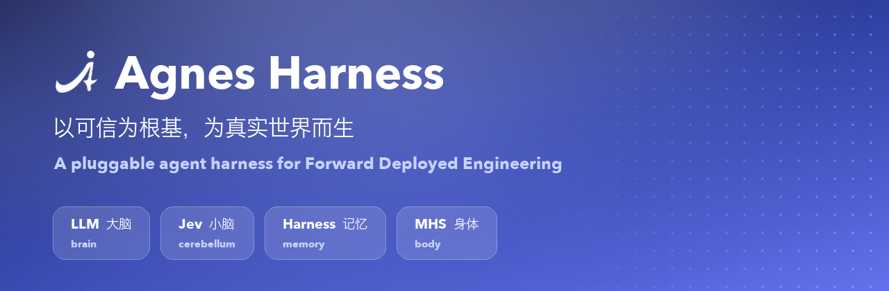
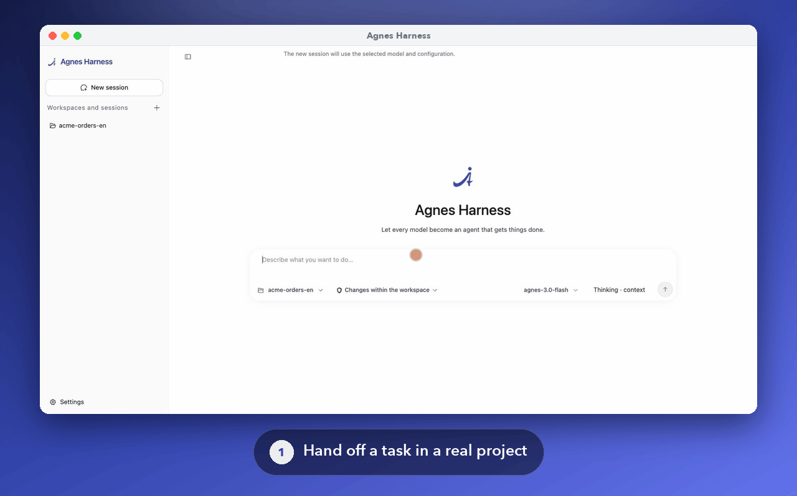
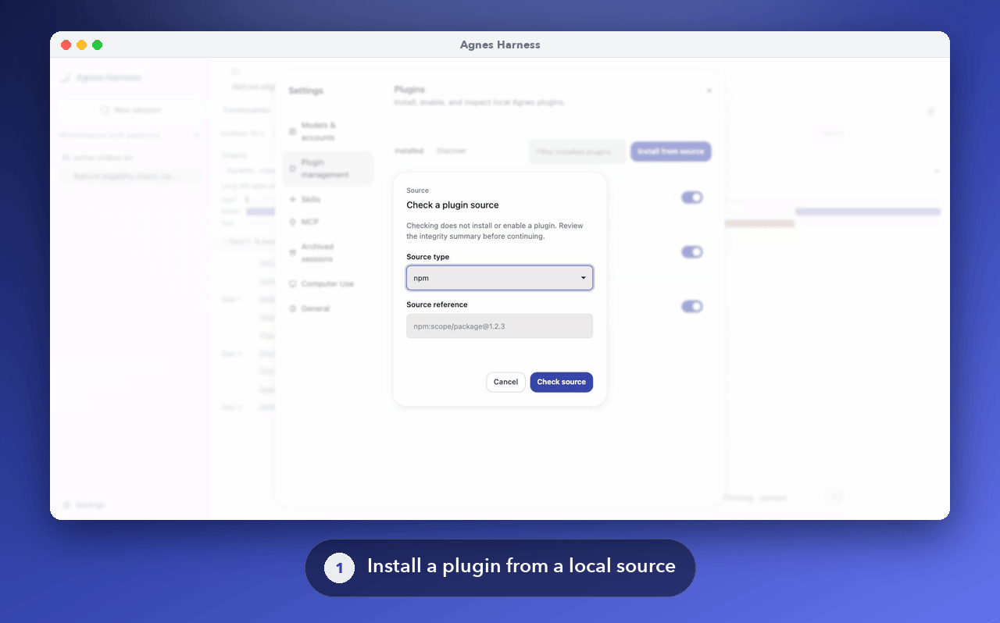
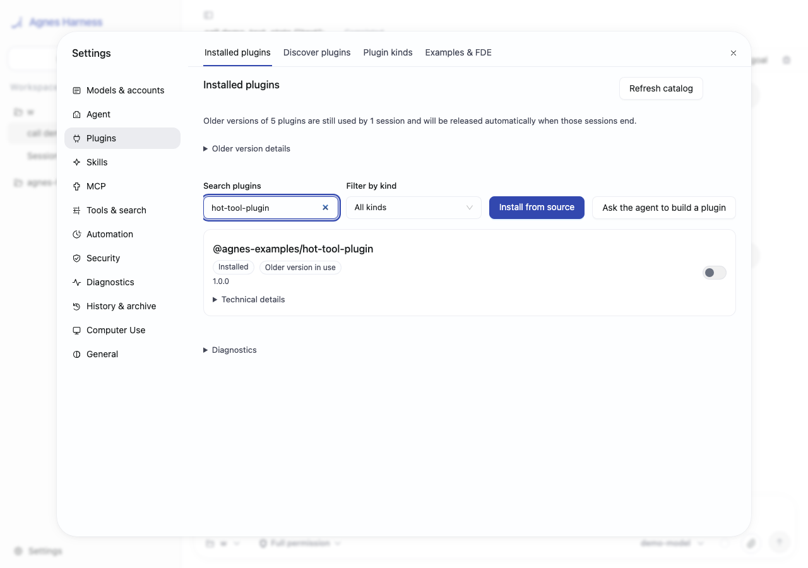
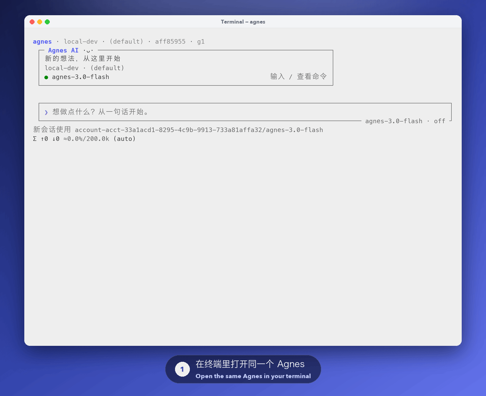
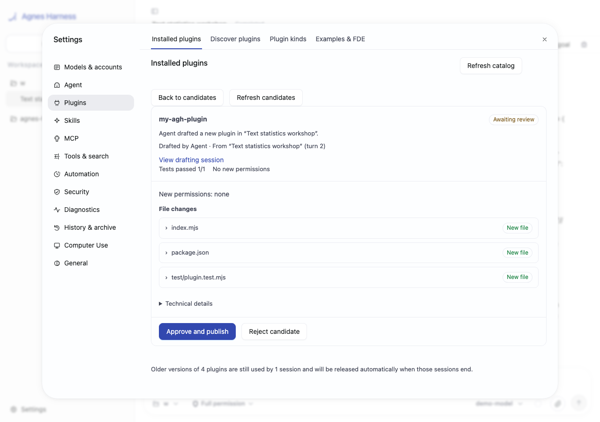
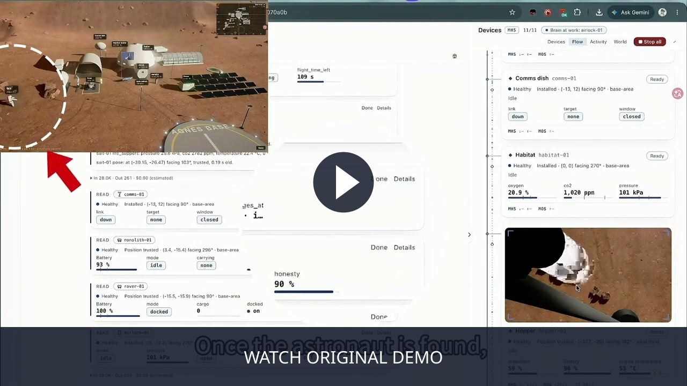
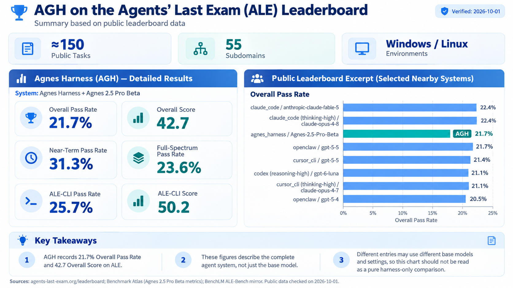

# Agnes Harness

English | [简体中文](README.zh-CN.md)

<p align="center">
  
</p>

<div align="center">

### Built for trust. Made for the real world.

**Bring AI into real workflows. Turn each deployment into plugins you can reuse.**


[Quickstart](docs/guide/quickstart.md) · [Architecture](#architecture) · [Write a plugin](#write-a-plugin) · [Try the examples](docs/guide/demo.md) · [Documentation](docs/README.md)

Developer preview (pre-alpha) · [Source build](#run-from-source) · [Apache-2.0](LICENSE)

</div>

> **Upgrading from the previous version?** This is a new release with no data migration. Read the [upgrade guide](docs/guide/upgrade-from-previous.md) first: back up and clean up the old environment, then start fresh.

<p align="center">
  
</p>

<p align="center">
  <b>LLM is the brain. Jev is the cerebellum. Harness is the memory. MHS is the body.</b><br />
  <sub>One open-source foundation for business agents, enterprise delivery and the physical world. <a href="#architecture">See the architecture</a></sub>
</p>

Taking AI into a real deployment is rarely about the model alone. It is about the customer's systems, the people who approve the work, and the details that differ at every site. Agnes Harness (AGH) connects models, tools, task state and business interfaces: **put the differences into plugins, let the harness run and record the work, and carry what you validated into the next deployment.**

<p align="center">
  
</p>

<p align="center"><sub>Read the code, ask before running a command, verify, answer, and record every step.</sub></p>

<details>
<summary><kbd>Contents</kbd></summary>

- [What AGH is, and what it is not](#what-agh-is-and-what-it-is-not)
- [Architecture: brain, cerebellum, memory and body](#architecture)
- [What AGH does for a deployment team](#what-agh-does-for-a-deployment-team)
- [Write a plugin](#write-a-plugin)
- [Demo videos and reproduction](#demo-videos-and-reproduction)
- [Public benchmark](#public-benchmark)
- [Run from source](#run-from-source)
- [New product and old environments](#new-product-and-old-environments)
- [Current status and roadmap](#current-status-and-roadmap)
- [FAQ](#faq)
- [Community and license](#community-and-license)

</details>

## What AGH is, and what it is not

AGH is an open-source agent harness built for Forward Deployed Engineering (FDE): working in users' environments to turn systems integration, a usable interface and ongoing iteration into delivered software. **Everything a deployment adds is a plugin**: tools, agent loops, model adapters, Web panels, Skills, connections and services. A plugin can also declare agents you launch directly, and an application that a deployment administrator adopts as the workbench. [Explore FDE and application scenarios →](docs/guide/why-agh.md)

What it is not, so you can choose the right trial:

- **Not a hosted service.** AGH is a developer preview that you build from source and run in your own environment.
- **Not a sandbox for arbitrary plugin code.** Ordinary backend plugins run as trusted in-process code; approvals and the command sandbox apply to the supported execution paths. See [security and trust](docs/guide/security.md).
- **Not a certified device driver.** MHS is AGH's own device protocol, independent of MCP. Device controllers keep real-time control and physical safety.
- **Not finished.** APIs, configuration and plugin interfaces are evolving and may change.

<a id="a-runtime-built-to-extend"></a>

<h2 id="architecture">Architecture: brain, cerebellum, memory and body</h2>

The brain, cerebellum, memory and body describe AGH's vision: combine reasoning, structured decisions, persistent task context and physical capabilities. Harness is the runtime; Jev and MHS join it as official plugins.



| Role | What it means in AGH | Current scope |
| --- | --- | --- |
| **LLM / brain** | Understand requests, reason about the task and propose actions | Model accounts and model-adapter plugins |
| **Jev / cerebellum** | TypeSafe Jev chooses each step; the conversation model only writes, fills parameters or reviews | Official optional loop plugin `@agnes/jev-loop`, installed from the Marketplace ([guide](docs/guide/jev-loop.md)) |
| **Harness / memory** | Session history, task state, execution records and reusable methods in Skills | The runtime itself: it runs, records, recovers and governs execution |
| **MHS / body** | Connect device capabilities so tasks can read physical state and request actions | Official plugin; integration in progress |

Clients (Web, CLI, terminal UI, SDK) connect to one App Server per home. Core owns durable facts, authorization and recovery. Workers host plugin generations; even the default loop is a plugin, `@agnes/loop-default`. Plugin code is pinned per session; MCP definitions and Skills are live resources filtered by the session's composition.

Follow the request path and source ownership in the [architecture guide](docs/develop/architecture.md) and [plugin contracts](docs/develop/architecture-plugins.md), or explore the [source map](docs/develop/source-map.md).

## What AGH does for a deployment team

### 1. Your business agent is a plugin

The agent needs your order lookup, your knowledge base, your internal API. Writing that into the agent itself means forking it for every customer.

In AGH, package a business loop, tools, model adapters, persona and Skills into one installable plugin, or connect an existing service through [MCP](docs/guide/mcp.md). Each session gets the capabilities it selected; a support agent's tools do not appear in an unrelated session. Installing a plugin shows its version, source, integrity digest, capabilities and license before anything runs. Business events can start work too: opt-in [GitHub and generic webhook triggers](docs/guide/webhooks.md) open ordinary sessions under the normal policy.

<p align="center">
  
</p>

[Plugin mechanism script](examples/demos/business-agent/README.md) · [Developer teaching examples](examples/fde/README.md) · [Acme application](examples/acme/README.md)

### 2. Upgrade without replacing work in progress

New sessions use the reviewed new plugin code; saved sessions keep their backend code (tools, hooks, loops and seams) across restarts. Uncertain external effects require reconciliation before another dispatch.



[Run the hot-upgrade demo](examples/demos/hot-upgrade/README.md) · [Sessions and recovery](docs/guide/sessions.md) · [Plugin lifecycle](docs/guide/packages.md)

### 3. Work starts on the Web and continues in the terminal

CLI, Web and SDK share the same backend sessions. Resume a Web session in the terminal with `/resume <id>` and the history, tool records and results are already there; whatever you add in the terminal shows up in the Web thread.

<p align="center">
  
</p>

### 4. "What did the AI change, and who approved it?"

Running a command waits for your approval by default: allow once, allow for the session, or deny. The Trace view keeps a timeline of model calls, tools and approvals. Package trust, tool approvals, execution constraints and session records give the integration explicit points of control. See [security and trust](docs/guide/security.md).

<p align="center">
  
</p>

### 5. The next deployment starts from the last one

Ask the agent to draft a Skill or plugin, test it, then review its files and permissions before publication. Provenance keeps the drafting session and the human review. Learned file memory can retain workspace preferences, with agent access off by default.



[Run the growing-skills demo](examples/demos/growing-skills/README.md) · [Candidate review](docs/extend/agent-built-plugins.md) · [Skills](docs/guide/skills.md) · [Memory](docs/guide/memory.md)

### 6. Each role needs its own screen

A support lead and a warehouse operator do not want the same interface. Add [frontend panels](docs/develop/frontend.md) to the Web workbench and connect them to backend services with [full-stack plugins](docs/develop/fullstack.md). The conversation dialog also takes [voice](docs/guide/voice.md): dictation, read-aloud and a hands-free voice conversation.

### 7. The site also has devices

From inspection to instrument coordination, field work connects device state, human judgment and business workflows. Agnes MHS (Model Hardware Standard) is AGH's own open device protocol: a device connects to AgnesHub, registers its state, tools and data sources, and takes calls; MOS (Model Observation Standard) streams what it observes. In this release MHS becomes an official plugin, and its integration is in progress.

<h2 id="write-a-plugin">Write a plugin</h2>

From a [built source checkout](#run-from-source), add an echo tool in an isolated home. No agent or application declaration is needed:

```sh
export AGH_SOURCE="$PWD"
export AGH_HOME="$(mktemp -d /tmp/agh-hello.XXXXXX)"
export AGH_HOME="$(cd "$AGH_HOME" && pwd -P)"
export AGNES_PROFILE=local-dev
AGH_WORKSPACE="$(mktemp -d /tmp/agh-hello-workspace.XXXXXX)"
cd "$AGH_WORKSPACE"
mkdir -p .agh/plugins
node "$AGH_SOURCE/templates/create-agh-plugin.mjs" tool hello-tool .agh/plugins/hello-tool --local
node "$AGH_SOURCE/agnes.mjs" dev .agh/plugins/hello-tool
node "$AGH_SOURCE/agnes.mjs" --new -p 'call plugin_hello_tool {"message":"hello"}'
```

The same template also starts a tool with a panel, an agent loop, a model adapter, or an MCP-and-Skills plugin. Each tutorial below includes source code, steps and expected results.

| Example | What you will see | What you can build from it |
| --- | --- | --- |
| [A tool](docs/develop/backend.md) | Invoke `demo_text_stats` and receive character and word counts | Order lookup, data retrieval or another business function |
| [A panel](docs/develop/frontend.md) | Load your own sidebar panel and update its version | Task information and business state for one role |
| [A full-stack plugin](docs/develop/fullstack.md) | Read a backend result from a panel, then inspect updates and rollback | A business service packaged with its interface |

[Plugin quickstart](docs/extend/quickstart.md) · [Plugin development](docs/develop/plugins.md) · [Try without a model account](docs/guide/demo.md#run-locally-without-a-model-account)

## Demo videos and reproduction

### MHS Mars rescue: coordinating devices

<p align="center">
  <a href="https://youtu.be/absoBkphEHE">
    
  </a>
</p>

Have the agent send the hopper to find an astronaut, then coordinate the robot and airlock to bring them back. AGH runs the task, AgnesHub calls devices through MHS, and MOS returns camera images, poses and other observations. The video was recorded on the previous release; reproduction steps return with the MHS plugin.

The [demo guide](docs/guide/demos.md) lists the runnable product demos and developer scripts. They use fresh isolated homes and a deterministic local model by default, and send no external business messages.

## Public benchmark

On the public [Agents' Last Exam (ALE) leaderboard](https://agents-last-exam.org/leaderboard), which evaluates complete agent systems (model, harness and tools) on professional tasks, Agnes Harness with Agnes 2.5 Pro Beta reaches a 21.7% overall pass rate and a 42.7 overall score.

<p align="center">
  
</p>

<p align="center"><sub>Results depend on model versions, settings and tool configurations. See the leaderboard for current figures.</sub></p>

<h2 id="run-from-source">Run from source</h2>

The runtime supports Node.js **24.10+**. Source builds use the exact patch in [`.node-version`](.node-version) through mise, pnpm **10.34.5** and your platform's native build tools ([installation](docs/guide/install.md)). Before running AGH, read [security and trust](docs/guide/security.md). From the repository root:

```sh
mise trust
mise install
mise exec -- node tools/toolchain/run.mjs install --frozen-lockfile
mise exec -- node tools/toolchain/run.mjs --filter @agnes/cli build:local
mise exec -- node agnes.mjs serve
```

Open the printed local URL. The [first-run guide](docs/guide/getting-started.md) walks through account setup, model selection and your first session; every step can be skipped. Model tests and real-model conversations may incur charges. Try your first request:

> Read this project and describe its main directories. Do not modify files or run installation commands.

Keep `serve` running. Another terminal with the same `AGH_HOME` and `AGNES_PROFILE` can run `node agnes.mjs` for the terminal UI, or `node agnes.mjs sessions --json` to find the shared history. See the [quickstart](docs/guide/quickstart.md) for the complete sequence. The documentation is available in [English](docs/README.md) and [简体中文](docs/README.zh-CN.md).

<a id="new-product-clean-home"></a>

## New product and old environments

Sessions, plugins, settings and accounts from the previous product do not carry over. Follow the [upgrade guide](docs/guide/upgrade-from-previous.md) to stop the old daemon, back up and move the old home and any applicable external directories, then configure a fresh environment. It covers macOS, Linux and Windows paths and the exact refusal messages. Startup never deletes or converts the old environment.

`E_HOME_VERSION` is a home-layout refusal; `E_DATA_DIR_STALE` / `E_DATA_DIR_NEWER` within a supported home use the separate [data-format recovery](docs/guide/install.md#data-format-and-upgrade) procedure.

## Current status and roadmap

AGH is a developer preview.

| Area | State |
| --- | --- |
| Web workbench, CLI and terminal UI, SDK on shared sessions | Available |
| Agent loop, tool approvals, Trace, recovery | Available |
| Plugins: tools, loops, model adapters, panels, Skills, hooks, MCP, services | Available, with documented constraints |
| Plugin upgrades that keep running sessions on their pinned code | Available |
| Agent-drafted Skills and plugins with human review | Available |
| Webhook triggers, voice in the dialog | Available, opt-in |
| Jev loop | Official optional plugin |
| MHS device integration | Official plugin, integration in progress |
| Command sandbox and execution constraints | Platform-dependent |
| Platforms | macOS and Linux have maintained checks; Windows is not yet tested end to end |

**Next:** connect the MHS plugin, test Windows end to end, and publish a public package release.

External effects are never promised exactly once, and ordinary plugin JavaScript is not isolated. See [supported scope and known limitations](docs/reference/limitations.md), the [verification guide](docs/maintainers/verification.md) and [network deployment](docs/guide/deployment.md).

## FAQ

**Can I use AGH in production?**
Not yet. AGH is a developer preview without a public package release, installer or upgrade commitment. Validate deployment, audit and isolation requirements in your own environment.

**Will my old sessions and settings carry over?**
No. This release starts from a fresh home; see [New product and old environments](#new-product-and-old-environments).

**Are plugins sandboxed?**
Ordinary backend plugins run as trusted in-process code, so install only packages you trust. Approvals and the command sandbox apply to the supported execution paths; they do not isolate arbitrary plugin code.

**Which models can I use?**
Models connect through model accounts and model-adapter plugins, and each provider's catalog determines the available capabilities. The demos on this page were recorded with Agnes AI `agnes-3.0-flash`; quality and tool selection vary by model.

**Can MHS control devices today?**
MHS is being connected as an official plugin in this release. Even when it is connected, canceling an AGH task does not establish that a device stopped safely; device controllers keep interlocks and emergency stops.

## Community and license

AGH is open source. **Star the project** and **Watch for updates** if you are bringing AI into real deployments.

- **Try it and give feedback:** run an example and open an Issue for bugs and use cases.
- **Build and share plugins:** develop plugins, connect tools and build workbenches in your own projects under the license.
- **Contribute code:** the core is developed by the maintainer team for now; code and documentation pull requests are by invitation. See the [contribution policy](CONTRIBUTING.md).

Report vulnerabilities privately under the [security policy](SECURITY.md).

Project-authored code is licensed under the [Apache License 2.0](LICENSE). Third-party components, adapted files and some examples retain their own license terms; see [NOTICE](NOTICE) and [licensing details](docs/maintainers/provenance.md).

<!-- Preserve historical README links. -->
<a id="agnes-harness"></a>
<a id="built-for-trust-made-for-the-real-world"></a>
<a id="architecture-brain-cerebellum-memory-and-body"></a>
<a id="1-every-customers-systems-are-different"></a>
<a id="2-work-starts-on-the-web-and-continues-in-the-terminal"></a>
<a id="3-what-did-the-ai-change-and-who-approved-it"></a>
<a id="4-each-role-needs-its-own-screen"></a>
<a id="5-the-next-deployment-should-start-from-the-last-one"></a>
<a id="6-the-site-also-has-devices"></a>
<a id="3-let-the-agent-grow-reusable-skills"></a>
<a id="who-it-is-for"></a>
<a id="start-from-an-example"></a>
<a id="current-status"></a>
<a id="follow-agh-and-bring-your-use-case"></a>
<a id="license"></a>
<a id="start-from-source"></a>
<a id="architecture-and-extension-paths"></a>
<a id="boundaries-to-understand"></a>
<a id="community-and-licensing"></a>
