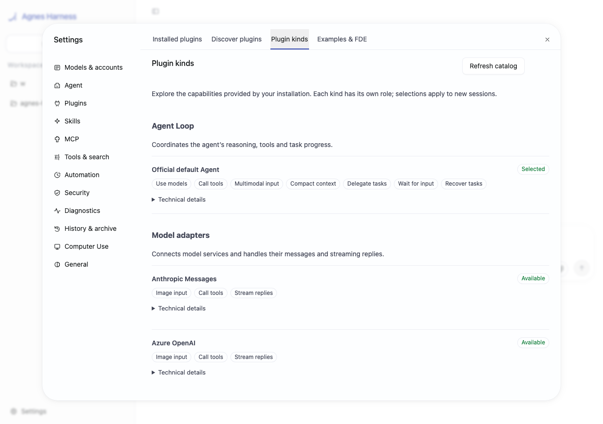

# Agnes Harness

English | [简体中文](README.zh-CN.md)

**AGH delivers business capabilities as installable plugins, launchable agents and adoptable applications.**

- A **plugin** is the installation, distribution and trust unit. It can provide tools, Loops, models, UI, skills, connections or services.
- An **agent** is a Bundle with its own explicit `launch`, referenced as `package#bundle`. It selects a Loop and preset to start a task.
- An **application** declares identity, presentation defaults and default/visible agents inside a plugin. A deployment administrator previews and explicitly adopts it; installation never switches applications.

**FDE (forward-deployed engineering) means building an application for an enterprise**: deliver business tools, agents and a workbench for the people doing the work. Existing backend modules still own execution and authorization.

Minimal tool plugin: from a built source checkout, add an echo tool in an isolated home. No agent or application declaration is required.

```sh
export AGH_SOURCE="$PWD"
export AGH_HOME="$(mktemp -d /tmp/agh-hello.XXXXXX)"
export AGH_HOME="$(cd "$AGH_HOME" && pwd -P)"
export AGNES_PROFILE=local-dev
AGH_WORKSPACE="$(mktemp -d /tmp/agh-hello-workspace.XXXXXX)"
cd "$AGH_WORKSPACE"
mkdir -p .agh/plugins
node "$AGH_SOURCE/templates/create-agh-plugin.mjs" tool hello-tool .agh/plugins/hello-tool --local
node "$AGH_SOURCE/agnes.mjs" dev .agh/plugins/hello-tool
node "$AGH_SOURCE/agnes.mjs" --new -p 'call plugin_hello_tool {"message":"hello"}'
```

[Quickstart](docs/guide/quickstart.md) · [Documentation](docs/README.md) · [Build a plugin](docs/extend/quickstart.md) · [Acme application](examples/acme/README.md)

<a id="1-your-business-agent-is-a-plugin"></a>

## 1. Deliver business agents in plugins

Package a business Loop, tools, model adapters, persona and Skills into an installable plugin. Each session gets its selected capabilities; a support agent's tools do not automatically appear in an unrelated default session. Add a workbench panel through the public frontend APIs.

Drive the agent from business events too: opt-in [GitHub and generic webhook triggers](docs/guide/webhooks.md) start ordinary workspace sessions under the normal policy.



[Product demos](docs/guide/demos.md) · [Developer teaching examples](examples/fde/README.md) · [Plugin mechanism script](examples/demos/business-agent/README.md)

## 2. Upgrade without replacing work in progress

New sessions use the reviewed new plugin code; saved sessions retain their backend code (tools, hooks, loops and seams) across restart, while profile pages follow the current activation and session renderers follow the session's pinned generation. Inspect model requests, tool results and recovery gaps through the trace and execution-evidence views. Uncertain external effects require reconciliation before another dispatch.


[Run the hot-upgrade demo](examples/demos/hot-upgrade/README.md) · [Read the recovery rules](docs/guide/sessions.md)

## 3. Let the agent grow reusable skills

Ask the agent to draft a Skill or plugin, test it, then review its files and permissions before publication. Provenance keeps the drafting session and human review. Learned file memory can retain workspace preferences, with agent access off by default.


[Run the growing-skills demo](examples/demos/growing-skills/README.md) · [Candidate review](docs/extend/agent-built-plugins.md) · [Memory](docs/guide/memory.md)

The screenshots illustrate trust and version behavior using synthetic browser fixtures; their menus may differ from the current interface. The runnable demos use fresh isolated homes and a deterministic local model by default; they do not send external business messages. Old code remains retained while durable session pins reference it, including idle history.

<a id="new-product-clean-home"></a>

## New product and old environments

This version ships as a new product built on the plugin architecture. It does not migrate or reuse the old product’s runtime data or trust digests. An old or unversioned home layout is refused with `E_HOME_VERSION`: preserve it and select a new, empty private `AGH_HOME` (`~/.agh` is the default). Configure accounts and plugins again there. Startup never deletes or converts the old home.

Copy the folder first if you want to keep old sessions.

For an existing supported home, `E_DATA_DIR_STALE` instead requires resetting only the named SQLite ledger and `tables/`, keeping `profiles/`; `E_DATA_DIR_NEWER` requires upgrading AGH. Nothing is migrated. See [data-format recovery](docs/guide/install.md#data-format-and-upgrade) for exact paths and data loss.

## Start from source

The runtime supports Node.js **24.10+**; source builds and checks use the exact development patch in [`.node-version`](.node-version) through mise, with pinned pnpm **10.34.5** and your platform's native toolchain ([installation](docs/guide/install.md)). Clone this repository and run from its root:

```sh
mise trust
mise install
mise exec -- node tools/toolchain/run.mjs install --frozen-lockfile
mise exec -- node tools/toolchain/run.mjs --filter @agnes/cli build:local
mise exec -- node agnes.mjs serve
```

Open the local URL printed by the terminal. The [first-run guide](docs/guide/getting-started.md) walks through account setup, model selection and your first session; every step can be skipped. Model tests and real-model conversations may incur charges. Try the [local Demo](docs/extend/quickstart.md) without a key, or run the [developer mechanism scripts](docs/guide/demos.md).

For your first request:

> Read this project and describe its main directories. Do not modify files or run installation commands.

Keep `serve` running. Another terminal with the same `AGH_HOME` and `AGNES_PROFILE` can run `node agnes.mjs` for the TUI, or `node agnes.mjs sessions --json` to find the shared history. See [Quickstart](docs/guide/quickstart.md) for the complete sequence.

## Architecture and extension paths

Clients connect to one App Server per canonical home. Workers host composed plugin generations; Core owns durable facts, authorization and recovery. The official default Loop is the separate `@agnes/loop-default` plugin. Storage and sandbox backends remain restart-required. Plugin code is pinned; MCP definitions and Skills are live resources filtered by the session composition.

[Architecture](docs/develop/architecture.md) · [Plugin contracts](docs/develop/architecture-plugins.md) · [App Server stdio](docs/reference/app-server.md) · [Source map](docs/develop/source-map.md)

## Boundaries to understand

- **External effects:** recovery does not promise exactly-once emails, remote writes or device actions. A missing receipt can leave an outcome unknown.
- **Trusted code:** ordinary backend plugins execute in process. Capability review, provenance, approvals and command/MCP sandboxing do not isolate arbitrary plugin JavaScript.
- **Preview release:** source builds are available; no public npm release, consumer installer or automatic-update commitment is made. APIs and configuration can change during preview.
- **Platforms:** macOS and Linux have maintained native/process/browser gates. Windows remains untested end to end, with no proven L1 command sandbox. Computer Use is unavailable on Linux.
- **Experimental paths:** provider/Loop APIs, child engines, programmatic cells (especially stateless CPython) need deployment-specific validation.

[Supported scope](docs/reference/limitations.md) · [Security](docs/guide/security.md) · [Verification](docs/maintainers/verification.md) · [Network deployment](docs/guide/deployment.md)

## Community and licensing

Use, study and extend AGH under its licenses. Issues welcome bug reports and use cases; code and documentation PRs currently require an invitation ([contribution policy](CONTRIBUTING.md)). Report vulnerabilities through [SECURITY.md](SECURITY.md).

Project-authored code uses [Apache-2.0](LICENSE). Third-party components and adapted examples retain their notices; see [NOTICE](NOTICE) and [licensing](docs/maintainers/provenance.md).

<!-- Preserve historical README links. -->
<a id="architecture"></a>
<a id="a-runtime-built-to-extend"></a>
<a id="agnes-harness"></a>
<a id="built-for-trust-made-for-the-real-world"></a>
<a id="what-agh-is-and-what-it-is-not"></a>
<a id="architecture-brain-cerebellum-memory-and-body"></a>
<a id="what-agh-does-for-a-deployment-team"></a>
<a id="1-every-customers-systems-are-different"></a>
<a id="2-work-starts-on-the-web-and-continues-in-the-terminal"></a>
<a id="3-what-did-the-ai-change-and-who-approved-it"></a>
<a id="4-each-role-needs-its-own-screen"></a>
<a id="5-the-next-deployment-should-start-from-the-last-one"></a>
<a id="6-the-site-also-has-devices"></a>
<a id="public-benchmark"></a>
<a id="who-it-is-for"></a>
<a id="start-from-an-example"></a>
<a id="run-from-source"></a>
<a id="current-status"></a>
<a id="faq"></a>
<a id="follow-agh-and-bring-your-use-case"></a>
<a id="license"></a>
