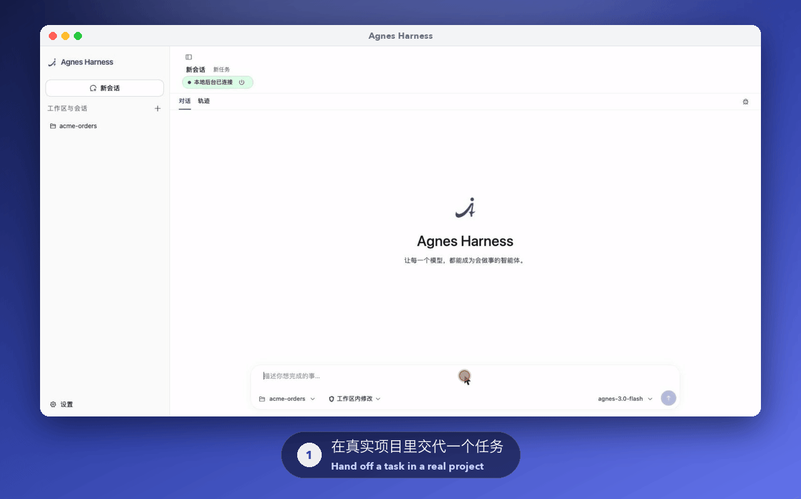
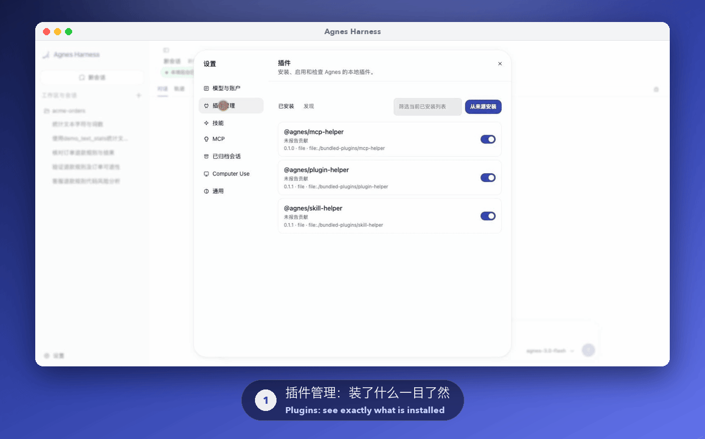
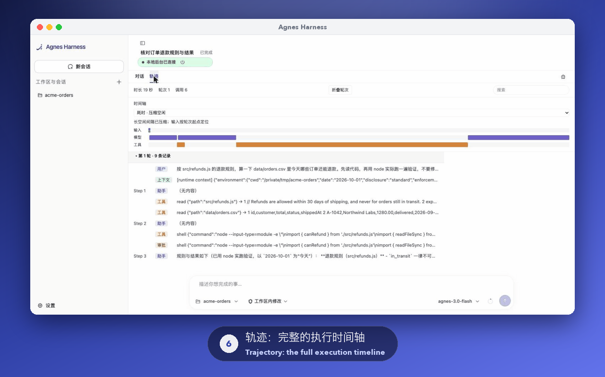
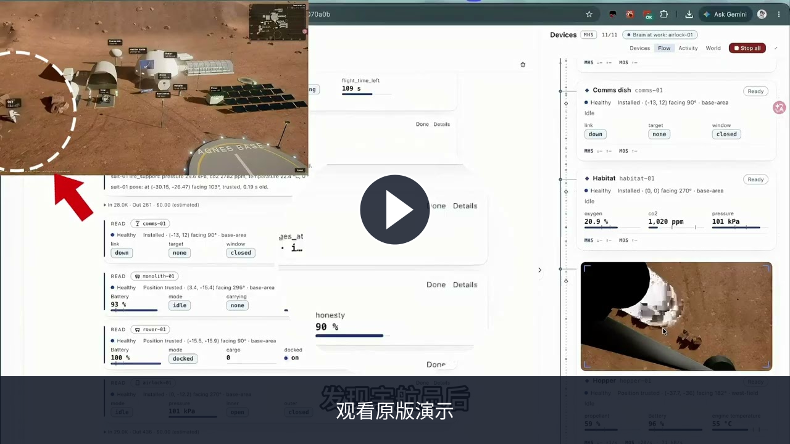

# Agnes Harness

[English](README.md) | 简体中文

<p align="center">
  
</p>

<div align="center">

### 以可信为根基，为真实世界而生。

**把 AI 接入真实业务，让每一次交付沉淀为可复用的插件。**


[快速开始](docs/guide/quickstart.zh-CN.md) · [架构](#architecture) · [写一个插件](#写一个插件) · [体验示例](docs/guide/demo.zh-CN.md) · [完整文档](docs/README.zh-CN.md)

开发者预览（pre-alpha） · [源码构建](#从源码开始) · [Apache-2.0](LICENSE)

</div>

> **从旧版升级？** 本次按新产品发布，不迁移旧数据。请先阅读[旧版升级指南](docs/guide/upgrade-from-previous.zh-CN.md)，备份并清理旧环境后再全新开始。

<p align="center">
  
</p>

<p align="center">
  <b>LLM 是大脑，Jev 是小脑，Harness 是记忆，MHS 是身体。</b><br />
  <sub>同一套开源底座，支撑业务智能体、企业交付与物理世界。<a href="#architecture">查看架构</a></sub>
</p>

把 AI 带进真实现场，难点往往不在模型本身，而在客户的业务系统、负责审批的人，以及每个现场都不一样的细节。Agnes Harness（AGH）把模型、工具、任务状态和业务界面连接在一起：**把现场差异写进插件，让 Harness 负责执行并留下记录，把验证过的能力带到下一个项目。**

<p align="center">
  
</p>

<p align="center"><sub>读代码、运行命令前先审批、验证、作答，每一步都留痕。</sub></p>

<details>
<summary><kbd>目录</kbd></summary>

- [AGH 是什么，不是什么](#agh-是什么不是什么)
- [架构：大脑、小脑、记忆与身体](#architecture)
- [在现场交付中，AGH 能帮上什么](#在现场交付中agh-能帮上什么)
- [写一个插件](#写一个插件)
- [案例演示与复现](#案例演示与复现)
- [公开评测](#公开评测)
- [从源码开始](#从源码开始)
- [新产品与旧环境](#新产品与旧环境)
- [当前状态与路线图](#当前状态与路线图)
- [常见问题](#常见问题)
- [社区与许可](#社区与许可)

</details>

## AGH 是什么，不是什么

AGH 是面向 Forward Deployed Engineering（FDE）的开源智能体框架：深入业务现场，把系统集成、使用体验和持续迭代做成可交付的软件。**现场新增的一切都是插件**：工具、运行方式（Loop）、模型适配器、Web 面板、Skills、连接与服务。插件还可以声明可直接启动的智能体，以及由部署管理员采纳为工作台的应用。[了解 FDE 与应用场景 →](docs/guide/why-agh.zh-CN.md)

为了帮你选对试用方式，先说清楚它不是什么：

- **不是托管服务。** AGH 是开发者预览版，需要从源码构建，在你自己的环境中运行。
- **不是任意插件代码的沙箱。** 普通后端插件作为受信代码在进程内运行；审批与命令沙箱作用于相应的受支持执行路径。详见[安全与信任](docs/guide/security.zh-CN.md)。
- **不是经过认证的设备驱动。** MHS 是 AGH 自己的设备协议，独立于 MCP。实时控制与物理安全仍由设备控制器负责。
- **还没有定型。** API、配置与插件接口仍在演进，可能出现破坏兼容性的变更。

<a id="为扩展而组织的运行基础"></a>

<h2 id="architecture">架构：大脑、小脑、记忆与身体</h2>

大脑、小脑、记忆与身体这组比喻表达 AGH 的产品愿景：把推理、结构化决策、持久任务上下文和物理能力组织到一起。Harness 是运行时本身，Jev 与 MHS 以官方插件的形式接入。



| 角色 | 在 AGH 中意味着什么 | 当前范围 |
| --- | --- | --- |
| **LLM / 大脑** | 理解请求、推理任务、提出行动建议 | 模型账户与模型适配器插件 |
| **Jev / 小脑** | 由 TypeSafe Jev 选择每一步，对话模型只负责撰写、补参数和复核 | 官方可选的运行方式插件 `@agnes/jev-loop`，从插件市场安装（[指南](docs/guide/jev-loop.zh-CN.md)） |
| **Harness / 记忆** | 会话历史、任务状态、执行记录，以及沉淀在 Skills 中的可复用方法 | 运行时本身：负责执行、记录、恢复与治理 |
| **MHS / 身体** | 连接设备能力，让任务读取物理状态、请求设备动作 | 官方插件，接入中 |

客户端（Web、CLI、终端界面、SDK）连接每个 home 对应的一个 App Server。Core 负责持久事实、授权与恢复。Worker 承载插件版本，连默认运行方式也是插件 `@agnes/loop-default`。插件代码固定到会话；MCP 定义与 Skills 是按会话组合过滤的动态资源。

实际请求链路与源码归属见[架构说明](docs/develop/architecture.zh-CN.md)与[插件合同](docs/develop/architecture-plugins.zh-CN.md)，深入实现可从[源码地图](docs/develop/source-map.zh-CN.md)开始。

## 在现场交付中，AGH 能帮上什么

### 1. 业务智能体就是一个插件

Agent 需要调用你的订单查询、知识库、内部接口。如果把这些写进 Agent 本身，每接一个客户就得改一版。

在 AGH 里，把业务运行方式、工具、模型适配器、角色与 Skills 打包成一个可安装的插件，或通过 [MCP](docs/guide/mcp.zh-CN.md) 连接已有服务。每个会话只获得所选能力，客服 Agent 的工具不会出现在无关会话中。安装前会先展示版本、来源、完整性摘要、能力与许可证。业务事件也能驱动 Agent：显式启用 [GitHub 与通用 Webhook 触发器](docs/guide/webhooks.zh-CN.md)，在正常策略下启动普通会话。

<p align="center">
  
</p>

[插件机制脚本](examples/demos/business-agent/README.zh-CN.md) · [开发者教学示例](examples/fde/README.zh-CN.md) · [Acme 应用](examples/acme/README.zh-CN.md)

### 2. 升级时，进行中的工作保留原版本

新会话使用审阅后的新插件代码，已有会话在重启后仍保留原后端代码（工具、hook、运行方式与 seam）。外部操作结果不确定时，必须先核对，再决定是否重新派发。


[运行热升级演示](examples/demos/hot-upgrade/README.zh-CN.md) · [会话与恢复](docs/guide/sessions.zh-CN.md) · [插件生命周期](docs/guide/packages.zh-CN.md)

### 3. 任务在 Web 上开始，在终端里继续

CLI、Web 与 SDK 共享同一套后台会话。在终端用 `/resume <id>` 恢复 Web 上的会话，历史、工具记录和结论都在；在终端里追加的内容，回到 Web 同样能看到。

<p align="center">
  
</p>

### 4. "AI 改了什么？谁批准的？"

默认情况下，运行命令要先经你批准：仅允许这次、本会话允许或拒绝。轨迹视图按时间轴记录模型调用、工具与审批。包信任、工具审批、执行约束与会话记录，让集成有明确的控制点。详见[安全与信任](docs/guide/security.zh-CN.md)。

<p align="center">
  
</p>

### 5. 下一个项目从上一个项目的终点出发

请 Agent 起草 Skill 或插件、运行测试，再由人审阅文件与权限后发布。来源记录保留起草会话与人工审阅信息。文件记忆可以保存工作区偏好，Agent 的记忆访问默认关闭。


[运行技能成长演示](examples/demos/growing-skills/README.zh-CN.md) · [候选审阅](docs/extend/agent-built-plugins.zh-CN.md) · [Skills](docs/guide/skills.zh-CN.md) · [记忆](docs/guide/memory.zh-CN.md)

### 6. 不同岗位需要不同的界面

客服主管和仓库操作员要的不是同一个界面。在 Web 工作台中加入[前端面板](docs/develop/frontend.zh-CN.md)，再通过[前后端联动插件](docs/develop/fullstack.zh-CN.md)连接后端服务。对话框也支持[语音](docs/guide/voice.zh-CN.md)：听写、朗读和免手动的语音对话。

### 7. 现场还有设备

从巡检到仪器协作，现场工作需要把设备状态、人的判断与业务流程连接起来。Agnes MHS（Model Hardware Standard）是 AGH 自己的开放设备协议：设备连接 AgnesHub，登记自己的状态、工具和数据源，然后接受调用；配套的 MOS（Model Observation Standard）实时推送设备观测到的内容。本版本中 MHS 成为官方插件，正在接入。

## 写一个插件

从[已构建的源码仓](#从源码开始)运行以下命令，在隔离环境中加入一个回显工具，无需声明智能体或应用：

```sh
export AGH_SOURCE="$PWD"
export AGH_HOME="$(mktemp -d /tmp/agh-hello.XXXXXX)"
export AGH_HOME="$(cd "$AGH_HOME" && pwd -P)"
export AGNES_PROFILE=local-dev
AGH_WORKSPACE="$(mktemp -d /tmp/agh-hello-workspace.XXXXXX)"
cd "$AGH_WORKSPACE"
mkdir -p .agh/plugins
node "$AGH_SOURCE/templates/create-agh-plugin.mjs" tool hello-tool .agh/plugins/hello-tool --local
node "$AGH_SOURCE/agnes.mjs" dev .agh/plugins/hello-tool
node "$AGH_SOURCE/agnes.mjs" --new -p 'call plugin_hello_tool {"message":"hello"}'
```

同一个模板还能生成带面板的工具、运行方式、模型适配器，以及 MCP 与 Skills 插件。下面每个教程都包含源码入口、操作步骤和预期结果。

| 示例 | 先看到什么 | 然后可以构建什么 |
| --- | --- | --- |
| [一个工具](docs/develop/backend.zh-CN.md) | 调用 `demo_text_stats`，得到字符数与词数 | 订单查询、数据检索等业务函数 |
| [一个面板](docs/develop/frontend.zh-CN.md) | 在工作台侧栏加载自己的面板，更新版本 | 为岗位展示任务信息和业务状态 |
| [一套联动](docs/develop/fullstack.zh-CN.md) | 面板读取后端服务结果，观察升级与回滚 | 把业务服务与操作界面组合成插件 |

[插件快速开始](docs/extend/quickstart.zh-CN.md) · [插件开发](docs/develop/plugins.zh-CN.md) · [不配置模型账号先体验](docs/guide/demo.zh-CN.md#不配置模型账号先跑通本地链路)

## 案例演示与复现

### MHS 火星救援：多设备协作

<p align="center">
  <a href="https://youtu.be/QbmD2KVli5Y">
    
  </a>
</p>

让 Agent 调度飞行器寻找宇航员，再协调机器人与气闸完成救援。AGH 组织任务，AgnesHub 经 MHS 调用设备，MOS 回传相机画面、位姿等观测数据。视频录制于上一版本；MHS 插件接入后补上复现步骤。

[演示指南](docs/guide/demos.zh-CN.md)列出可运行的产品演示与开发者脚本。它们默认使用全新隔离 home 和确定性本地模型，不发送外部业务消息。

## 公开评测

在公开的 [Agents' Last Exam（ALE）排行榜](https://agents-last-exam.org/leaderboard)上（评测对象是完整的 Agent 系统：模型 + Harness + 工具，任务来自真实的专业工作场景），Agnes Harness 搭配 Agnes 2.5 Pro Beta 的总通过率为 21.7%，总得分 42.7。

<p align="center">
  
</p>

<p align="center"><sub>成绩随模型版本、设置与工具配置而变化，以榜单最新数据为准。</sub></p>

## 从源码开始

运行时支持 Node.js **24.10+**；源码构建须通过 mise 使用 [`.node-version`](.node-version) 固定的补丁版本、pnpm **10.34.5** 与平台原生构建工具（[安装指南](docs/guide/install.zh-CN.md)）。首次运行前阅读[安全与信任](docs/guide/security.zh-CN.md)。在仓库根目录运行：

```sh
mise trust
mise install
mise exec -- node tools/toolchain/run.mjs install --frozen-lockfile
mise exec -- node tools/toolchain/run.mjs --filter @agnes/cli build:local
mise exec -- node agnes.mjs serve
```

打开终端打印的本机地址。[首次运行指南](docs/guide/getting-started.zh-CN.md)带你配置账号、选择模型并创建会话，每一步都可跳过。模型测试和真实模型对话可能产生费用。第一个请求可以是：

> 请只读取当前项目，说明主要目录的用途；不要修改文件或运行安装命令。

保持 `serve` 运行。在使用相同 `AGH_HOME` 与 `AGNES_PROFILE` 的另一个终端运行 `node agnes.mjs` 打开终端界面，或运行 `node agnes.mjs sessions --json` 查找共享历史。完整步骤见[快速开始](docs/guide/quickstart.zh-CN.md)。完整文档提供[英文](docs/README.md)与[简体中文](docs/README.zh-CN.md)版本。

<a id="new-product-clean-home"></a>

## 新产品与旧环境

旧产品的会话、插件、设置和账户不继承。请按[旧版升级指南](docs/guide/upgrade-from-previous.zh-CN.md)停止旧后台、备份并移走旧 home 及适用的外部目录，再配置新环境；指南包含 macOS、Linux、Windows 的路径、操作和准确拒绝文案。启动不会自动删除或转换旧环境。

`E_HOME_VERSION` 是 home 布局拒绝；受支持 home 内的 `E_DATA_DIR_STALE`／`E_DATA_DIR_NEWER` 则使用独立的[数据格式恢复](docs/guide/install.zh-CN.md#数据格式与升级)流程。

## 当前状态与路线图

AGH 当前为开发者预览。

| 方面 | 状态 |
| --- | --- |
| Web 工作台、CLI 与终端界面、SDK 共享会话 | 可用 |
| Agent 循环、工具审批、轨迹记录、恢复 | 可用 |
| 插件：工具、运行方式、模型适配器、面板、Skills、hooks、MCP、服务 | 可用，有已记录的限制 |
| 插件升级时，进行中的会话保留原版本代码 | 可用 |
| Agent 起草 Skill 与插件，人工审阅后发布 | 可用 |
| Webhook 触发、对话框语音 | 可用，需显式开启 |
| Jev 运行方式 | 官方可选插件 |
| MHS 设备接入 | 官方插件，接入中 |
| 命令沙箱与执行约束 | 取决于平台 |
| 平台 | macOS 与 Linux 有持续维护的检查；Windows 尚未完成端到端验证 |

**接下来：** 接入 MHS 插件、完成 Windows 端到端验证、发布公开安装包。

恢复不承诺外部副作用恰好执行一次，普通插件 JavaScript 也不被隔离。详见[支持范围与已知限制](docs/reference/limitations.zh-CN.md)、[验证与复现](docs/maintainers/verification.zh-CN.md)与[网络部署](docs/guide/deployment.zh-CN.md)。

## 常见问题

**能用于生产环境吗？**
暂时还不能。AGH 是开发者预览版，没有公开的包发布、安装程序或升级承诺。部署、审计与隔离要求需要在你自己的环境中验证。

**旧版的会话和设置能带过来吗？**
不能。本版本从全新的 home 开始，见[新产品与旧环境](#新产品与旧环境)。

**插件运行在沙箱里吗？**
普通后端插件作为受信代码在进程内运行，所以只安装你信任的插件包。审批与命令沙箱作用于相应的受支持执行路径，并不隔离任意插件代码。

**可以用哪些模型？**
模型经模型账户与模型适配器插件接入，可用能力由各家的模型目录决定。本页演示使用 Agnes AI `agnes-3.0-flash` 录制；不同模型的质量与工具选择会有差异。

**MHS 现在能控制设备吗？**
本版本中 MHS 正以官方插件的形式接入。即使接入完成，在 AGH 中取消任务也不等于设备已安全停止；互锁与急停由设备控制器负责。

## 社区与许可

AGH 是开源项目。如果你也在探索 AI 的现场交付，欢迎 **Star 收藏项目**，用 **Watch 关注更新**。

- **试用与反馈**：跑通一个示例，通过 Issues 提交问题与场景建议。
- **构建与分享插件**：按许可证在自己的项目中开发插件、接入工具、打造工作台。
- **贡献代码**：核心代码目前由维护团队开发，代码与文档 PR 暂限受邀开发者，详见[协作规则](CONTRIBUTING.md)。

安全问题请按[安全报告政策](SECURITY.md)私密提交。

项目自有代码采用 [Apache License 2.0](LICENSE)。第三方组件、改编文件及部分示例保留各自的许可声明，详见 [NOTICE](NOTICE) 与[许可说明](docs/maintainers/provenance.zh-CN.md)。

<!-- Preserve historical README links. -->
<a id="agnes-harness"></a>
<a id="以可信为根基为真实世界而生"></a>
<a id="架构大脑小脑记忆与身体"></a>
<a id="1-每个客户的业务系统都不一样"></a>
<a id="2-任务在-web-上开始在终端里继续"></a>
<a id="3-ai-改了什么谁批准的"></a>
<a id="4-不同岗位需要不同的界面"></a>
<a id="5-下一个项目应该从上一个项目的终点出发"></a>
<a id="6-现场还有设备"></a>
<a id="1-业务-agent-就是插件"></a>
<a id="1-用插件交付业务智能体"></a>
<a id="3-让-agent-积累可复用技能"></a>
<a id="适合谁"></a>
<a id="从示例开始"></a>
<a id="当前状态"></a>
<a id="关注-agh把你的场景带进来"></a>
<a id="开源许可"></a>
<a id="架构与扩展入口"></a>
<a id="使用边界"></a>
