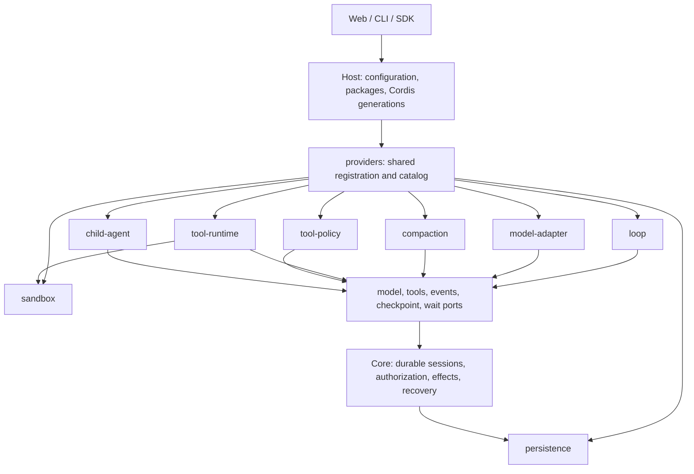

# Plugin and provider architecture

English | [简体中文](architecture-plugins.zh-CN.md)

[Architecture](architecture.md) · [State ownership](state-ownership.md) · [Source map](source-map.md) · [Author guide](../extend/README.md) · [v0.1 contracts](contracts-v0.1.md)

Plugins are fully trusted code running with the user's rights. Capability declarations are reviewed at admission; they do not restrict arbitrary JavaScript or enforce a hook allowlist. `ctx.hooks.register` accepts the supported observe, transform and intercept hooks regardless of the declared `hooks` list. Use only code you intend to authorize.

The kernel keeps session facts, ledger writes, effects, authorization and recovery. Replaceable algorithms use operation ports. Host loads packages into Cordis, owns their registrations and instances, and supplies the selected providers to Core. Ordinary backend plugins execute as trusted in-process code; this composition mechanism does not isolate arbitrary plugin code.



Ordinary concurrent inventory reads for one profile share only a pending scan. Each scan reads capability and source policy once, verifies an official catalog signature against its immutable configuration, and verifies each installed and rollback tree. Package changes, fresh publication checks and service authorization start a new read boundary; completed inventories are never reused across rounds. A bounded, manager-local cache reuses only static inspection results after verifying the entire tree's digest again (the directory hash reuses a digest while file metadata is unchanged, below), keyed by package identity, lock entry, verified content and capability ceiling. Fresh reads bypass that cache; workspace and local packages always receive full inspection. Trust, activation, provenance policy and transaction recovery remain current. Session generation and composition filtering remain separate from the installed inventory.

Application consent envelope validation belongs to `packages/package-manager/src/application-contract.ts`. Adoption preview, direct-launch coverage and Host role admission use the same package/integrity/application identity and canonical declaration/envelope digest checks. Each caller still owns its admission conditions: dependency baseline availability, active adoption and the complete launch plan, or enabled package and explicitly delegable agents.

Read-only package RPCs and session-open admission explicitly open one verification operation. Nested readers propagate it through async call context and reuse only successful directory digests keyed by canonical directory, exact version, integrity, tree integrity, capability hash and digest formula. Runtime-store validation still binds each snapshot id to its canonical directory and validates every reference. The operation is closed and cleared on success or failure. Below it, the directory hash itself reuses a tree's digest within one process while the root's dev/ino and every file's relative path, size, mtime and inode are unchanged, and stores nothing for a tree with a file written in the two seconds before hashing began. This applies to every caller, including copy, import, execution and publication gates and editable sources, except generation creation, which hashes its new archive in full without reused digests: performance is ranked above a strict re-read. A same-size rewrite that restores mtime is therefore not seen until the tree is replaced, the process restarts or a verification refusal clears the store; such a rewrite made by plugin code between a gate's before and after checks is not seen either. A cache hit still walks the tree and refuses symbolic links and special entries. Trust, policy, source binding and application/role consent are checked independently on each read. Writes, recovery mutations and fresh publication reads clear and suspend prior observations. Both full-tree and publish digest formulas remain unchanged.

Worker runtime-source reads opt into a process-local exception: installed, builtin and runtime-snapshot trees reuse a successful digest while the canonical path, exact expected identity and root inode match. Replacing the directory forces a full hash; editing files in place does not. Workspace/local trees and independent import/execute gates still hash their bytes. One target application shares its source-read promise across compositions. A mismatched digest, failed tree read or rejected verification clears settled successes in that process and fences older in-flight results; independent write/admission gates also invalidate them. This does not broadcast negative evidence between daemon and worker processes. A fresh worker starts with no settled digests.

Only Worker runtime-source reads may consume this settled-tree exception; generation writers and publishers cannot. Generation creation invalidates previous evidence, clones each package into independent file inodes (copy-on-write where available, plain copies otherwise), and freshly hashes the destination before publishing it. Creation read-back validates the record and resources without repeating those package hashes; independent archive reads and imports still verify the bytes. Unchanged compositions retain their generation only after the backend rechecks the running sources’ current trust and capability bindings.

Inventory, application, client-module, skin, model-catalog and runtime-snapshot reads, plus the read phase of new-session bundle inspection, hash asynchronously on the daemon/worker event loop. Identical concurrent hashes inside one operation share pending work; invalidation or operation completion prevents late results from entering its memo, and failures are retried. Each access still checks the root type and canonical path. Async walks retain file-handle and root checks and recheck file identity, size, mtime and ctime before returning. Transaction, recovery, copy, activation and import/execute gates keep their existing verification paths.

Model pickers read configured routes plus the release-owned model catalog without starting a worker or preparing a session. An already running worker can return only live registration/model metadata and active source identities; these are matched to the current operation's verified grants without calling session composition/admission. Successful Host assembly/publication also writes a display-only community adapter catalog beside the profile, including offered model ids/routes and exact source identities. Every query verifies current package/snapshot bytes and grants before reading that projection; a different profile, source version, revoked grant or missing/corrupt projection contributes no community choice. This projection stores no factories, credentials or permission decisions and cannot authorize execution. Community registration metadata becomes visible after successful ordinary activation/assembly. Session start and launch still perform full admission; loop and complete runtime administration retain their runtime catalog path.

Async inventory and snapshot readers yield between package verifications, including runtime-store recovery checks; synchronous transaction readers use the same verification body. Read-only runtime-pin enumeration overlaps up to four independent snapshot validators through the existing file-check pool, settles all started validators before reporting failure, and still checks every snapshot, including unpinned ones. Static package preflight and credential-reference collection join the enclosing read operation; module import retains fresh before/after byte checks. Ordinary read operations do not retain completed verification across requests. These paths use the same filesystem and path contracts on Windows and macOS. Client-resource publication copies the batch before one fresh inventory check, then withdraws any changed package before returning the roster or persisting publication state. Each copied package must still match its installed identity, directory, trust and enable state.

At Host startup, the complete selected immutable snapshot set passes identity, trust/profile, generation, API/runtime, entry, duplicate-row and static dependency checks before any of those modules is imported. `runtimePrepareConcurrency` bounds preparation to 1–4 (default 4 for reviewed independent sources); `runtimePrepareIndependent` is a Host-owned review of exact `{ packageId, snapshotId }` pairs, including importer reentrancy and module side effects. An empty dependency list alone does not prove independence. Unknown snapshots and sources linked by package or declared service dependencies remain serial barriers. The existing module Promise cache and immediately-before/after-import tree verification remain in force. Runtime preparation and row verification hash snapshots asynchronously in bounded chunks, using the same digest format; no timestamp-based validity cache is used. A failed or cancelled batch drains every started prepare and collects its failures before returning; registration and Cordis dependency activation keep their existing order. These options do not change plugin manifest admission or permissions.

## One provider pattern

Every kind describes validation, capabilities, semver identity and lifecycle scope with `defineKind<T>()` from `@agnes/extension-api`. Host's `ProviderRegistry<T>` owns registration, duplicate refusal, selection, immutable catalogs and disposal. Registration may be owned by a plugin fiber; unregister returns an idempotent `Promise<void>`. Model, compaction, policy and tool-runtime owners stop admission, abort and drain creates/calls, dispose instances, then run registration cleanup. Cleanup failures are aggregated. Loop identity is `id@version`; the other current kinds refuse duplicate ids.

An author can register an existing kind through one service:

```ts
export const plugin = {
  inject: ['providers'],
  apply(ctx) {
    ctx.providers.register(toolPolicyKind, {
      id: 'read-only', version: '1.0.0',
      decide(input) {
        return input.policy.isReadOnly && !input.policy.isDestructive
          ? { effect: 'allow', reason: 'Read-only call' }
          : { effect: 'deny', reason: 'This preset permits reads only' }
      },
    })
  },
}
```

Tool policies and runtimes register and appear in catalogs only through `providers`; their typed selection, execution and cancel/dispose wrappers stay with their owners. Named services (`loops`, `modelAdapters`, `compactionEngines`, `sandboxProviders`, `childAgents`) retain their instance APIs. The common entry point delegates to the owning lifecycle and source-package checks. Contributors adding a kind use `installProviderRegistry(ctx, defineKind({...}))` from `@agnes/host`, then fit its operations behind a typed facade. The persistence registry remains process-owned: packages export `persistenceProvider` before the store opens, and that same registry joins the combined catalog after Cordis starts.

## Selection and compatibility

The canonical block is `<kind>: { provider: id, version?: version }`. Write these blocks in the profile's `providers` table. For example:

```yaml
providers:
  loop: { provider: 'example.research', version: '1.0.0' }
  tool-policy: { provider: 'read-only' }
  compaction: { provider: 'default' }
  child-agent: { provider: 'in-process' }
```

A profile selects every provider in one table, `providers.<kind>: { provider, version? }`: the seven seam kinds and `loop`, `compaction`, `model-adapter`, `persistence`, `sandbox`, `tool-runtime`, `tool-policy`, `child-agent` and `memory`. Nothing else in a profile carries a selection: `seams`, top-level `persistence` / `sandbox.provider` / `memory` / `child-agent`, profile `composition.<kind>` and package `config.<kind>` are refused with the sentence that names the table. `model-adapter.provider` accepts an id, a source package or a list of either, preserving multiple wire transports. A preset writes its own choices in a `providers` table of the same shape (also `tool-runtime` and `tool-policy`) and a bundle, admin or session composition patch carries a `providers` table; each is a layer over the profile's table, never another spelling. The system prompt's `model.system_prompt.provider` is the one exception: it stays inside the prompt configuration object that user settings and presets share.

`child-agent: { provider, version? }` selects the default for `childAgents.start(undefined, task, options)`. An explicit provider id still selects that provider. Omitting configuration keeps `in-process`; a missing configured provider fails instead of falling back. Existing in-process subagent tools retain their explicit in-process path. When fitted, `LoopContext.children` uses the parent-bound `ChildAgentSessionService` facade and configured provider selection. Providers register through `ctx.providers.register(childAgentKind, provider)`; the platform owns registration cleanup.

A versionless loop selection requires exactly one installed version. An explicit version must match; missing or ambiguous providers fail with an installation or configuration hint. Core still pins the resolved loop id and version in the session, and legacy sessions map to `agnes.default@1.0.0`. Resume does not silently switch to an installed alternative.

`host.providers.catalog()` (also `ctx.providers.catalog()`) returns every installed kind with `id`, `version`, `sourcePackage`, a capability list, `scope`, derived `restartRequired`, `active` and `selectedFor`. This read-only view contains no factories or credentials. Active means selected by the reported profile/default or fitted provider scope, not the number of running sessions. Uninstalled providers are absent; future kinds join when their service is installed. Admin and config-dump integrations can consume this port without another registry or HTTP endpoint.

| Kind | Default | Replacement / lifecycle |
| --- | --- | --- |
| `loop` | `agnes.default@1.0.0`, `@agnes/loop-default` | Select for new sessions; persisted id/version governs resume. Registrations reload with Cordis. |
| `model-adapter` | API-specific adapters from `@agnes/ai` | Model-profile updates rebuild validated routes; unload disposes owned instances. |
| `compaction` | `default`, Base | Generation scope: a new Host generation assembles its runner; existing sessions retain their code. |
| `tool-runtime` | `default`, Core | Preset selection; session instances own scheduling and cancellation. |
| `tool-policy` | `default`, Base approval policy | Selected per preset; principal authorization remains in Core. |
| `persistence` | `sqlite`, Host | Process startup selection; restart required. Providers do not migrate another store's files. |
| `sandbox` | `local`, Host | Startup selection, bound on first workspace; restart required to change it. |
| `child-agent` | `in-process`, Base | Defined with `defineKind`; `childAgents` remains the typed facade. Optional `acp` stays unloaded by default. Fiber unload aborts the provider lifetime and disposes its handles; capability checks and session allowlists still apply. |

## Pinned code, live resources

Host facades classify every member as session-owned or deployment management. Session runtime ports resolve the durable generation/composition binding; a new Host or Kernel member without a classification fails type checking, and an unclassified JavaScript port is refused. Collected session runtimes must be reopened through `Host.createSession` before runtime operations or direct Kernel admission. Raw ledger/view reads use an explicit shared deployment-storage port: they neither open a runtime nor require a readable code pin. Deployment operations resolve the active container when called, including previously captured methods.

Sessions persist their plugin code generation: packages, loops, providers and tool implementations stay pinned across hibernation and restart. MCP server definitions and Skills are live resources, filtered by the session’s composition. Added, updated or removed resources take effect on the session’s next turn; disabling an MCP server removes it from new turns of every session. Unchanged MCP servers share one connection across code generations within a worker and opener/policy scope, keyed by the effective transport configuration and resolved credential boundary, with reference-counted leases; the connection closes when its last generation/session reference is released. Cold resume resolves the pinned code snapshot and current resources, and waits for the first MCP catalog sync with a bounded timeout.

Model routes, catalogues and credential-store configuration are live too: `Host.applyModelProfile` broadcasts to all retained code containers, while each container keeps its adapter registry. Cold containers start with the current configuration. Non-model backend changes remain refused.

Disabling a package that supplies a session composition’s selected Loop drains that composition. It keeps its original code container and publishes only live resources until the Loop is enabled again; new sessions cannot bind the disabled bundle. Its retained code is reported as draining, and explicit migration is refused while that Loop is unavailable. Resumed work retains its existing Loop pin.

Interactive profile reads and Bundle presentation use cooperative installed-tree verification. A
configuration service retains a bounded byte-keyed static-inspection cache, but every request still
hashes current files and rechecks trust. Overlapping runtime-source reads share only unfinished work
at the same policy/lock/runtime boundary. Bundle metadata reads do not occupy the session mutation
queue; executable session admission remains serialized and independently verified.

Composite-target readers reread SQLite on every access and may reuse validation only for identical
stored bytes. Decoded targets are reused only for immutable artifacts issued by that store. Historical
client assets keep per-generation publication queues; overlapping archive verification is keyed by
the exact generation record and discarded on completion or failure. Unchanged client-roster state
is not rewritten; byte verification, revocation and expiry checks still run on every read, except for
the display reads described next.

The client-module roster, the application state and client-module asset reads may reuse the last
completely verified installed inventory (`inventory(…, { settled: true })`) instead of taking the
package lock and hashing every installed tree again. It is reused only until a package write starts
or ends in this process, or the lock, capability-policy or source-configuration file changes, and it is
dropped when a verifying read fails. Hand edits to installed package files made in between are noticed
at the next package write, `fresh` read, session admission or daemon restart; asset bytes are still
checked against their snapshot hashes when served. Publication, authorization, service and effect calls,
and application or role adoption keep their ordinary or `fresh` reads. A package that declares nothing
but the `ui` capability needs no backend confirmation: its descriptor-declared client row is published
from the daemon's own desired tree without waiting for a worker report.

Cold composition/generation restoration uses cooperative archive reads rather than synchronous tree
walks. Extension and plugin-configuration schema compilers retain at most 64 successful validators
and 4 MiB of schema keys each, keyed by the complete inspected JSON snapshot. Every call still
inspects author input, validates current values and checks authority independently. Compilers keep
isolated reference namespaces; changed schemas, invalid defaults, async or remote schemas never
inherit an earlier verdict. These caches are populated by normal use, not startup prewarming.
Resource archives share successful tree digests only within that admission's verification operation;
the next operation and mutation gates discard those observations. Canonical rows and target encodings
may reuse only deeply immutable objects issued by their own builders, with weak ownership tracking.
Foreign objects (including shallow-frozen ones) and all wire artifacts retain complete validation;
decoding still returns fresh values and canonical bytes/digests do not change.
Runtime-state readers reread disk and may reuse pure metadata decoding for the same complete JSON
content (at most four cached states and 4 MiB of keys), returning independent working copies. File-tree
verification and current trust/activation decisions remain outside this metadata cache.

### Publication and recovery

Cold composition admission restores its durable generation directly, without first assembling or
archiving a temporary default generation. Current desired code can still fork a separate container;
historical pins, seam selections and current trust checks remain authoritative. Boot and session
compositions use the same declared package-source vocabulary. Distinct durable
generation ids may share a Host only after archive validation and exact code, resources, seam and
source-metadata equality; their pins are not rewritten, and children inherit the parent's generation.
Package verification overlaps at most four file reads, preserves digest order, drains all handles on failure and performs
the final full-file mutation sweep. Builtin manifest locations are indexed per assembly, while
PowerShell facts are process-local and re-probed when executable candidates or configuration change.
Supervisor-gated workers with no initial MCP rows archive their first accepted complete target instead
of the temporary assembly tree. `boot_ready` still waits for durable archival; an archival failure
refuses startup and can be retried. Ordinary Host creation keeps its immediate generation contract.

Composition publication uses independent convergence, rather than a global atomic transaction. `applyRuntimeTarget` and `extensionRows.apply` return a convergence report with `publication`; `refreshSkillRow` and `applyModelProfile` return a `HostPublicationReport` on composition Hosts (ordinary Hosts retain their void result). Each report identifies the operation, every `compositionHash`, its `applied`/`failed` result and error, and `recovery: 'retry-same-input'`. All existing containers are attempted, including those after a failure. Successfully applied containers keep their new state; failed containers may retain prior state or partially converge, and new containers receive the latest desired input. Repeat the same complete input to converge failed containers. `compositionPublicationStatus()` exposes the last report. Callers must inspect `ok`; `assertHostPublication` raises `HostPublicationError` carrying the report for compatibility callers, including worker resource/config commands. Failure does not mean an atomic rollback occurred.

### Historical session retention

Code snapshots stay retained while any durable session pin refers to them, including idle history. Closing or hibernating a session does not expire its pin. Memory has a separate lifetime: the current container stays live, and a retired container stays live while it owns an open session. After its last session closes or hibernates, Host closes the container after `limits["worker.generation_idle_close_ms"]` (default 60,000 ms; a non-negative integer, with 0 collecting immediately). An unreferenced timer runs collection even without another publication. Resuming a collected generation rebuilds it from its retained snapshot through `resolve(id)`, including the original code and current trusted live resources. There is no implicit time-based upgrade. A privileged session coordinator may call `Host.migrateSessionGeneration(sessionKey)` after closing the session and excluding concurrent admission. This migrates only that session to the current generation of its existing composition; it preserves the ledger, loop id/version and composition binding. Both snapshots must be available and compatible, and the target must resolve the exact pinned loop. An open session, missing snapshot or incompatible deployment is refused before changing the pin. Migration is idempotent and returns `{ previousGenerationId, generationId, changed }`.

The same idle limit applies to extra composition containers, including their current generation.
A container is eligible only after all sessions, admitted calls and retained invocation leases have
drained. The initial control container remains live. Durable composition bindings and code snapshots
survive reclamation, so reopening rebuilds the original composition with current live resources.

Once the last pin moves or the session is deleted (`releaseSessionGeneration`), collection disposes the old container and removes its snapshot. Archives owned by another live worker remain conservatively protected until that owner collects or exits. Migration changes plugin implementation behavior explicitly; it does not promise migration of plugin-defined state/checkpoint schemas. Use `agh sessions migrate <key> [--profile <name>] [--json]` for a closed historical session. The daemon checks authenticated session ownership and `packages.activate`, and fences concurrent admission until the worker replies or exits. Open or opening sessions are refused without interrupting their turn. No automatic migration or model-facing tool is installed.

The Node SDK exposes `client.packages.migrateSession({ profile, clientId, commandId, sessionId })` through `_agnes/v1/sessions.migrate`. Each request resolves the compatible current generation; after a transport failure inspect/retry explicitly, since a pin write may have committed. Publication status is `client.packages.publicationStatus({ profile })` / `_agnes/v1/plugins.publicationStatus`, or `agh plugins publication-status [--profile <name>] [--json]`. It returns `{ publication: report | null }`: null means this worker has no recorded composition publication yet, including after restart. Reports retain per-container applied/failed results and retry-same-input recovery; plugin exception text is replaced with a safe failure message.

The exact-origin admin BFF serves read-only `GET /admin/plugins/api/publication-status` (profile bound by the launcher; no query parameters) and the equivalent scoped POST. Both require `packages.read` and remain available in read-only recovery mode. `POST /admin/plugins/api/sessions/migrate` takes the migration DTO above, requires activation authority, and is refused in read-only mode. The Web API helpers are `PluginAdminApi.publicationStatus()` and `migrateSession(sessionId)`; the launcher keeps its Node credential private. Migration refusals return a safe 409 code such as `E_GENERATION_SESSION_OPEN`, while incompatible or missing pins remain unchanged.

Restart scope distinguishes backend changes from code publication: storage, sandbox, platform and fitted adapters require a process/worker restart and compatible deployment for resume. A new generation reconstructs generation-owned registries/runners for new sessions; existing sessions retain their code. Bundled implementation replacement remains restart-required where Host publication refuses it. The provider catalogue describes kind/instance lifecycle requirements; generation status describes the actual deployment publication restriction.

## The plugin ladder

Each rung works without learning the next: **0 Use** — select installed plugins and presets; **1 Skill** — write `SKILL.md`; **2 Connect** — configure MCP; **3 Tool** — write a JS/TS tool; **4 Panel** — add a client panel; **5 Brain** — replace a model adapter, compaction engine or policy; **6 Loop** — supply a complete driver; **7 Bundle** — compose the pieces as configuration. Beginners enter through tools and Skills; researchers swap algorithms; FDE teams distribute bundles; core contributors maintain the ports and shared provider lifecycle.


## Provider author contracts

Every kind uses its exact invariant token: `register(kind, provider)` and `resolve(kind, selection)` infer the provider type from it. Custom kinds use the token returned by `defineKind<T>()` and installed by their service. A token with the same name but a different identity is refused. The Host derives `sourcePackage` from the verified plugin row; the author does not pass it.

Service providers use that same registry. `defineKind({ bind })` adds cardinality, an instance scope, and the maximum port grant (`ledger`, `input`, `projections`). Host installs one descriptor, which can only shrink the grant, and admits the current callback through `ctx.providers`. The loader supplies the package id and the manifest supplies the owner. Each admitted call opens its own instance. A handle used after that callback, generation, or dispose fails closed. Process-wide sharing stays inside the feature that already reference-counts the resource.

Feedback is the first feature on this path: one provider per profile, a new instance per request, and workspace scope so replacing that provider's code waits for a process restart. Sending feedback, drafting a Skill candidate, and live configuration do not restart.

Intelligent UI is a generation-scoped, single provider per session. Host and the official plugin share the kind token from `@agnes/intelligent-ui-contract`. Tools bind it with `providers.bindOwn`. User actions and reads enter through the session port, which admits the authenticated actor and resolves SC1 delivery from the durable action fact. Result keys stay exact (`ui-result:`).

UI data sources are a separate kind, `ui-data-source`, from that same contract package. Cardinality is multi, instance scope is request, and scope is generation. A session binds one source by provider id. The kind is its own token, and its ports stay empty. The rules are in [UI data sources](intelligent-ui.md#ui-data-sources).

Git worktrees are one workspace-scoped provider for each canonical workspace. Host and the bundled subagent share `gitWorktreeKind` from `@agnes/git-worktree-contract`. Host registers that provider; plugins cannot. The subagent binds it with `providers.bindOwn` during a tool call. Git metadata stays in host-infrastructure, and the subagent does not receive a shell or argv port.

Provider failures use `ProviderError`, separate from the closed extension-call error set: `E_PROVIDER_DUPLICATE`, `E_PROVIDER_UNKNOWN`, `E_PROVIDER_INVALID`, `E_PROVIDER_INCOMPATIBLE` and `E_PROVIDER_UNAVAILABLE`. Each carries `kind`, optional `provider`, `operation`, `retryable`, optional `hint` and original `cause`. Duplicate registration no longer reports an API-range error.

Every filesystem-loaded ordinary plugin entry in `agnes.plugins` must declare `apiRange`, for example `"^5.0.0"`. Host checks static metadata before importing code, independently of `hostProvidedExternals`. Existing manifests must add this field. Provider `version` is semver (the built-in persistence version is now `1.0.0`); package version, provider version, contract range and checkpoint codec version have separate meanings. Extension API is `5.0.0`; a plugin that declares `^4` is refused with `E_API_RANGE` until its range and removed author entry points are migrated. `ModelAdapter.wireApi` names its wire format and is the only field exposed by adapter catalogs. `Route.api` selects the registration id.

Scopes are session (`loop`, `tool-runtime`, `child-agent`), generation (`model-adapter`, `compaction`, `tool-policy`) and process (`persistence`, `sandbox`). Custom kinds may declare workspace scope. Workspace/process scopes derive `restartRequired`; generation publication also checks the registered package's scopes. Backend seam rows retain their startup constraints where no provider contract describes them.

`@agnes/plugin-runtime` exports `defineProvider`, `defineLoop`, `defineModelAdapter`, `defineToolRuntime`, `defineToolPolicy`, `defineCompactionEngine`, `defineSandboxProvider`, `definePersistenceProvider` and `defineChildAgentProvider`. The helpers preserve inferred declarations and validate identity/operations early; Host still validates registrations. Model, compaction and tool-runtime factories can return promises and receive a creation signal. Compaction instances and policies may dispose owned resources; registrations may clean up shared resources. Await unregister before releasing a plugin's dependencies. Cancellation requests cooperative termination: a provider must settle started work after abort, or unload remains pending rather than claiming a completed drain.

`@agnes/extension-api/testkit` publishes `runProviderConformance` and a named runner for each of the eight kinds. Use `@agnes/host/author-testkit` for ordinary author tests. Supply the registration port captured inside an isolated Host plugin and an `open` probe using the real Host service or session path. Each probe starts a controlled operation and reports when it reaches the provider, so the suite can check cancellation and unload without timing guesses. Loop and persistence probes must verify cold resume; other probes can opt in. The suites check rejection, immutable metadata, cancellation, idempotent draining unload and missing-provider refusal. They deliberately fail if a provider ignores cancellation or a facade returns before work drains.

## Session capability resolution

`resolveSessionCapabilities()` is the pure Host decision boundary. It returns a deeply frozen `SessionCapabilitySet`; factories, configuration bodies, credentials and paths never enter the public result. Registries retain ownership and lifecycle duties. Their read facades, invocation policy, MCP/Skill views, Loop/model admission, child admission and client-module checks consume the resolver instead of repeating membership predicates.

| Order | Input and effect |
| --- | --- |
| 1 | Builtin defaults and the resolved profile, including inherited profile bundles, establish the base and package ceiling. |
| 2 | Preset bundles, then preset composition, replace selected fields. |
| 3 | Admin bundles, then admin composition/default Loop, establish defaults for new sessions. |
| 4 | Explicit session bundles, then session parameters, override those defaults. |
| 5 | A durable binding uses its compiled composition and owning code generation instead of recompiling today's defaults. Legacy bindings retain their unfiltered tool/resource catalogs and bypass bundle ownership scope. |
| 6 | The owning generation's installed catalog and current MCP/Skills/model resources determine available items. Refresh changes resources without rebinding code. |
| 7 | Package/bundle ownership, plugin enablement, model input support, tool selection, read-only/allow/deny policy, MCP ownership, UI/surface selection and child allowlists are intersected. Any failed check excludes the item. |

Each item carries `enabled` and `reasons[{source:{layer,name},rule}]`; excluded items retain refusal reasons. Scalar selections carry their source, and `codePin` carries safe generation/package identities. Empty tools/MCP/Skills lists retain defaults; an explicit empty policy allowlist, surface list or shell module/slot list denies all. MCP local and stable public tool names use the same server selection; shared MCP resource bridges check their `server` argument.

`Session.capabilities()` reads the optional `capabilities` field of the existing authenticated `_agnes/v1/session.tools` result (`undefined` for older servers); `agh tools --json` exposes that same result. `PluginAdminApi.composition(preset?)` reads `CompositionCapabilitySnapshot` through the existing composition GET/POST route, also used by `agh config dump`. Its top-level set is static desired inspection: catalog-dependent lists remain empty when no catalog is supplied. `sessions[].capabilities` records actual live session facts. `sessions[].toolGroups` remains a display compatibility adapter until clients switch; it is not an authorization input.

Read-only backend state dependencies can register `workspaceStateKind`. It grants no execution, ledger or write ports. Base's plan backend supplies a `plan-mode` state provider, while approval policy declares the optional `planMode` dependency in its manifest; removing a client view does not remove enforcement. The plan operations are the ordinary `plan.status` query and `plan.command` effect. The latter accepts the `/plan` command grammar and requires authenticated human workspace control.

Service callers can resolve an entire contract through `Host.resolveService(sessionId, names)`. Resolution uses the session's pinned Host and requires one owner to supply every requested service; missing or ambiguous contracts confer no authority. Subsequent calls still pass through the normal service grant, principal, workspace and query/effect checks. This is how the shared jobs UI supports community backends without package-name routing.

Host-held capabilities follow release assembly policy, separate from author manifest permissions. Host binds each grant to the enabled release package and its loaded module and factories. File loaders pin and reverify the tree and directory identity before handing out grants; retained extension rows carry the tree revision through the existing generation pin. Embedded and internal memory loaders bind the Host-owned code image. Installed snapshots cannot borrow release grants by copying a name. Core consumes Host-supplied execution-domain attestation without recognizing package names. Host-owned live resource rows carry a private mount revision; their names do not decide code-generation membership.

The distribution package assembles release provider rows and model metadata; package-manager owns its release policy, bundled payload catalogue and profile templates. Host consumes that assembly through the ordinary row path. Child-engine ownership and built-in client query bridges come from the same policy. Package declarations retain precedence over compatibility defaults.
