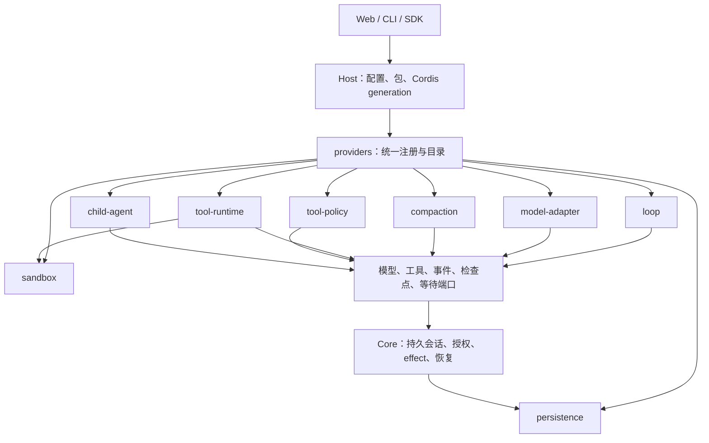

# 插件与 provider 架构

[English](architecture-plugins.md) | 简体中文

[架构](architecture.zh-CN.md) · [状态归属](state-ownership.zh-CN.md) · [源码导航](source-map.zh-CN.md) · [作者指南](../extend/README.zh-CN.md) · [v0.1 合同](contracts-v0.1.zh-CN.md)

插件是完全受信任的代码，以用户权限运行。能力声明用于准入审核，不限制任意 JavaScript，也不强制 hook 白名单。`ctx.hooks.register` 接受受支持的 observe、transform、intercept hooks，不按声明的 `hooks` 列表限制注册。只授权你愿意执行的代码。

内核保存会话事实，负责账本写入、effect、授权与恢复；可替换的算法通过操作端口运行。Host 将包加载到 Cordis，管理注册项与实例，再把选中的 provider 交给 Core。普通后端插件作为受信任的进程内代码执行；组合机制不会隔离任意插件代码。



普通的同一 profile 并发 inventory 读取只共享尚在进行的扫描。每轮各读取一次能力策略和来源配置，在不可变配置副本内核验官方目录签名，并验证每个已安装及回滚目录。包变更、发布后的新验证与服务授权开启新的读取边界；已完成名册默认不跨轮复用。客户端模块名册、应用状态与模块资源读取例外：它们可复用上一次完整校验的清单（`inventory(…, { settled: true })`），不再取包锁、不再重新哈希所有已安装包；复用只持续到本进程内有包写操作开始或结束、或锁文件、能力策略、来源配置文件变化，校验失败的读取会使它作废。其间对已安装包文件的手工改动，在下一次包写操作、`fresh` 读取、会话准入或 daemon 重启时发现；资源字节被送出前仍按快照哈希校验。发布、授权、服务与效果调用、应用与角色采纳仍用普通或 `fresh` 读取。只声明 `ui` 能力的包没有后端行为要确认：其描述符声明的浏览器行由 daemon 自己的期望树发布，不等 worker 报告。会话代际与组合过滤仍独立于已安装名册。

应用同意封套校验由 `packages/package-manager/src/application-contract.ts` 负责。采纳预览、直接启动覆盖检查与 Host 角色准入共用包、integrity、application 身份及规范声明/封套摘要检查。各调用方仍拥有自己的准入条件：依赖基线是否可用、当前采纳状态与完整启动计划，或包已启用且智能体明确可委派。

只读包 RPC 和会话打开准入显式开启一次校验操作。嵌套读取通过异步调用上下文传递作用域，仅复用成功的目录摘要；键包含规范目录、精确版本、integrity、treeIntegrity、capabilityHash 和摘要公式。快照存储仍将 snapshotId 绑定到规范目录并校验每个引用。成功或失败结束时均清空作用域，下一普通请求重新哈希，同大小且恢复时间戳的篡改也不会被缓存掩盖。信任、策略、来源绑定以及应用/角色同意独立复核。写事务、恢复变更和 fresh 发布读取清空并隔离此前结果；复制、导入和执行保留独立的前后校验。完整树摘要与发布摘要的公式均不变。

worker 的运行来源读取显式启用进程内例外：安装目录、内置包及运行快照树在规范路径、精确预期身份和根目录 inode 一致时复用成功摘要。替换目录会触发完整哈希，原地修改文件则不会。workspace/local 树及独立的导入/执行门仍读取字节。一轮目标应用在各组合之间共享来源读取 Promise。摘要不匹配、目录读取失败或校验被拒绝时，清除本进程已保留的成功值，并阻止更早的在途结果写回；独立写入/准入门也使它们失效。失败证据不会在 daemon 与 worker 进程之间广播。新 worker 启动时没有保留摘要。

inventory、应用、客户端模块、皮肤、模型目录、运行快照读取，以及新会话 Bundle 检查的纯读取阶段，在 daemon/worker 事件循环上异步计算哈希。同一操作内完全相同的并发哈希共享进行中的工作；失效或操作结束后，晚完成的结果不能写回 memo，失败会重新校验。每次访问仍检查根目录类型和规范路径。异步遍历保留文件句柄与根目录检查，返回前复核文件身份、大小、mtime 和 ctime。事务、恢复、复制、激活与导入/执行门沿用原有校验路径。

模型选择器读取当前路由和发行版模型目录，不启动 worker，也不准备会话。已有 worker 时仅读取实时注册/模型描述和激活来源身份，与本次已验证授权匹配，不调用会话组合/准入。Host 成功组装或发布时，在 profile 旁写入仅用于展示的第三方适配器目录，包含模型 id/路由及精确来源身份。每次查询重新验证包/快照字节与当前授权；profile 或来源版本改变、撤权、投影缺失或损坏时不提供对应第三方选项。投影不存工厂、凭据或权限决定，也不能授权执行；第三方注册信息在正常激活/组装成功后可见。会话创建和智能体启动仍执行完整准入；运行方式及完整运行管理保留运行时目录路径。

异步 inventory 与快照读取在包校验之间让出事件循环，运行时存储恢复检查也如此；同步事务读取使用同一套校验逻辑。只读运行 pin 枚举复用现有文件检查池，最多并行校验四棵独立快照树，失败时等待所有已启动校验结束，未被 pin 引用的快照也须全部校验。静态包预检查与凭据引用收集加入所在的只读校验操作，模块导入仍保留独立的前后字节检查，普通读取操作不跨请求保留已完成的校验。Windows 与 macOS 使用相同的文件系统和路径契约。客户端资源发布先复制本批资源，再读取一次 fresh inventory，在返回名册或持久化发布状态前撤销发生变化的包。每个复制项仍须匹配安装身份、目录、信任和启用状态。

Host 启动时，选中的不可变快照集合先完成身份、信任/profile、generation、API/runtime、入口、重复 row 与静态依赖检查，再导入其中任何模块。`runtimePrepareConcurrency` 将准备并发限制在 1–4（已复核独立来源默认 4）；`runtimePrepareIndependent` 由 Host 对精确的 `{ packageId, snapshotId }` 指定已复核的独立性，包括导入器可重入性和模块副作用。仅凭空依赖列表不能认定独立。未确认的快照、存在包依赖或声明的服务依赖的来源仍形成串行屏障。原有模块 Promise 缓存及紧邻导入前后的目录核验继续生效。失败或取消的批次等待所有已启动准备结束并收集错误，然后返回；注册和 Cordis 依赖激活保持原顺序。这些选项不改变插件清单准入或权限。

安装清单只合并同一轮尚未完成的读取；完成的清单不跨轮复用。进程内有界缓存仅复用静态检查结果，每轮仍重新读取完整树并核对摘要，缓存键包含包身份、锁条目、内容摘要和能力上限。fresh 读取绕过缓存，workspace/local 包始终完整检查；信任、启用状态、来源策略和事务恢复仍按当前事实裁决。运行时准备与行验证通过异步分块读取计算同格式摘要，导入前后继续验证，不根据文件时间戳判断有效性。

交互中的 profile 解析与 Bundle 展示使用可让出事件循环的安装目录校验。配置服务保留有界、按已验证字节标识的静态检查结果，但每次请求仍重新哈希文件并核对当前信任。运行来源读取仅在策略、锁与运行快照边界一致时共享尚未完成的工作。Bundle 展示读取不占用会话修改队列，实际会话准入仍串行执行并独立验证。

组合目标每次访问仍读取 SQLite；仅完全相同的存储内容可复用校验结果，且只对存储自身返回的不可变 artifact 复用解码目标。历史客户端资源保留各 generation 的发布队列；重叠的归档校验按完整 generation 记录匹配，完成或失败后立即清除。客户端名册状态未改变时不再重写文件，但每次读取仍执行字节校验、撤权与过期检查。

## 一套 provider 模式

每种类型通过 `@agnes/extension-api` 的 `defineKind<T>()` 描述校验、能力、身份与重启要求。Host 的 `ProviderRegistry<T>` 统一管理注册、重复拒绝、选择、只读目录和释放。注册项可归插件 fiber 所有；卸载时注销并执行原有资源清理。loop 按 `id@version` 注册，其他现有类型拒绝重复 id。

作者可以通过同一个服务注册已有类型：

```ts
export const plugin = {
  inject: ['providers'],
  apply(ctx) {
    ctx.providers.register(toolPolicyKind, {
      id: 'read-only', version: '1.0.0',
      decide(input) {
        return input.policy.isReadOnly && !input.policy.isDestructive
          ? { effect: 'allow', reason: 'Read-only call' }
          : { effect: 'deny', reason: 'This preset permits reads only' }
      },
    })
  },
}
```

tool-policy 与 tool-runtime 只通过 `providers` 注册和读取目录；类型化选型、执行与 cancel/dispose 包装仍留在原 owner。`loops`、`modelAdapters`、`compactionEngines`、`sandboxProviders`、`childAgents` 保留实例 API；统一入口委托各 owner 执行生命周期与来源包核对。贡献者添加类型时使用 `@agnes/host` 的 `installProviderRegistry(ctx, defineKind({...}))`，再为操作提供类型化外观。persistence 保留进程级启动生命周期：包在打开存储前导出 `persistenceProvider`，同一注册表在 Cordis 启动后加入统一目录。

## 选择与兼容

统一配置块是 `<kind>: { provider: id, version?: version }`，写在配置档的 `providers` 表里：

```yaml
providers:
  loop: { provider: 'example.research', version: '1.0.0' }
  tool-policy: { provider: 'read-only' }
  compaction: { provider: 'default' }
  child-agent: { provider: 'in-process' }
```

配置档在一张表里选择所有 provider：`providers.<kind>: { provider, version? }`，覆盖七个 seam 种类以及 `loop`、`compaction`、`model-adapter`、`persistence`、`sandbox`、`tool-runtime`、`tool-policy`、`child-agent`、`memory`。配置档里没有别的选择位置：`seams`、顶层 `persistence` / `sandbox.provider` / `memory` / `child-agent`、配置档的 `composition.<kind>` 和包的 `config.<kind>` 都会被拒绝，报错会指向这张表。`model-adapter.provider` 接受注册 id、来源包或它们的列表，保留同时使用多种 wire 协议的能力。Preset 在自己的 `providers` 表里写同样形状的选择（还包括 `tool-runtime` 和 `tool-policy`），bundle、admin 和 session 的 composition patch 也带 `providers` 表；它们都是叠在配置档这张表之上的层，不是另一种写法。唯一例外是 system prompt 的 `model.system_prompt.provider`：它留在用户设置与 preset 共用的提示词配置对象里。

`child-agent: { provider, version? }` 选择 `childAgents.start(undefined, task, options)` 使用的默认 provider；显式传入 id 仍选择指定 provider。未配置时保留 `in-process`，配置的 provider 缺失时拒绝而不回退。既有进程内 subagent 工具保留显式进程内路径。可选 `LoopContext.children` 使用绑定父会话的 `ChildAgentSessionService` facade，并按配置选择 provider。作者可使用 `ctx.providers.register(childAgentKind, provider)`，注册清理由平台绑定到插件生命周期。

loop 省略版本时必须恰好安装一个版本。显式版本必须匹配；缺失或歧义都会返回安装或配置修复提示。Core 仍在会话中固定实际解析出的 loop id/version；旧会话映射到 `agnes.default@1.0.0`，恢复不会悄悄换成另一个已安装版本。

`host.providers.catalog()` 和 `ctx.providers.catalog()` 返回所有已安装类型的 `id`、`version`、`sourcePackage`、能力列表、`scope`、由作用域推导的 `restartRequired`、`active` 和 `selectedFor`，不包含工厂或凭据。active 表示被当前 profile、默认值或已绑定 provider 范围选中，不代表正在运行的会话数。卸载项不在目录中；后续类型在其服务安装后加入。管理端和 config dump 可直接消费此只读端口，无需再建注册表或 HTTP 接口。

| 类型 | 默认实现 | 替换与生命周期 |
| --- | --- | --- |
| `loop` | `@agnes/loop-default` 的 `agnes.default@1.0.0` | 新会话可选择；恢复遵循持久化 id/version；注册项随 Cordis 重载。 |
| `model-adapter` | `@agnes/ai` 提供的各 API 适配器 | 模型 profile 更新重建已校验路由；卸载释放所属实例。 |
| `compaction` | Base 的 `default` | 新版本按插件版本代数装配 runner；已有会话保留原代码。 |
| `tool-runtime` | Core 的 `default` | preset 选择；会话实例负责调度与取消。 |
| `tool-policy` | Base approval policy 的 `default` | preset 选择；主体授权仍由 Core 决定。 |
| `persistence` | Host 的 `sqlite` | 启动选择，变更需重启；不会迁移其他 provider 的文件。 |
| `sandbox` | Host 的 `local` | 启动选择、首个 workspace 绑定，变更需重启。 |
| `child-agent` | Base 的 `in-process` | 用 `defineKind` 定义，`childAgents` 保留类型化外观。可选 `acp` 默认不加载。fiber 卸载会中止 provider 生命周期并释放所属 handle；能力检查与会话 allowlist 继续有效。 |

## 插件阶梯

每一级都可以独立学习：**0 使用**——选择插件和 preset；**1 Skill**——编写 `SKILL.md`；**2 连接**——配置 MCP；**3 Tool**——编写 JS/TS 工具；**4 Panel**——添加客户端面板；**5 Brain**——替换模型适配器、压缩引擎或策略；**6 Loop**——提供完整 driver；**7 Bundle**——用配置组合以上能力。新手从工具与 Skill 起步，研究者替换算法，FDE 团队交付 bundle，内核贡献者维护端口与统一生命周期。

<a id="pinned-code-live-resources"></a>


## 固定代码，动态资源

Host 门面将每个成员明确分类为会话所有或部署管理。会话运行时端口解析持久化的 generation/composition 绑定；新增 Host 或 Kernel 成员若未分类，类型检查失败，未分类的 JavaScript 端口也会被拒绝。已回收的会话运行时必须先通过 `Host.createSession` 重开，才能执行运行时操作或直接从 Kernel 打开会话。原始账本及视图读取显式使用共享的部署存储端口，不打开运行时，也不要求代码 pin 可读。部署操作在调用时解析当前容器，提前保存的方法引用也遵循这一规则。

会话持久化插件代码 generation：包、loop、provider 和工具实现跨休眠与重启保持固定。MCP 服务器定义与 Skills 是动态资源，仍按会话的 composition 过滤。资源新增、更新或删除在同一会话的下一轮生效；禁用 MCP 服务器后，所有会话的新一轮都不再看到它。同一 worker 与 opener/策略作用域内，按实际传输配置及已解析凭据边界，未修改的 MCP 服务器跨代码 generation 共享一条连接，每个使用方持有引用计数租约，最后一个 generation/会话引用释放时关闭连接。冷恢复解析固定的代码快照与当前资源，并在有超时上限的等待中完成首次 MCP 工具目录同步。


模型路由、目录及凭据存储配置同样是实时配置：`Host.applyModelProfile` 广播到所有保留的代码容器，各容器的 adapter 注册表保持固定。冷恢复容器使用当前配置；非模型后端变更仍被拒绝。

禁用提供会话 composition 所选 Loop 的包时，该 composition 进入排空状态：保留原代码容器，仅发布动态资源，直到该 Loop 再次启用；新会话不能绑定已禁用的 bundle。保留的代码显示为 draining，Loop 不可用期间拒绝显式迁移。恢复中的任务沿用已有 Loop pin。

冷态 composition/generation 恢复使用协作式归档读取，避免同步遍历目录。扩展与插件配置 Schema 编译器分别最多保留 64 个成功校验器、4 MiB 的 Schema 键，键来自完整且已检查的 JSON 快照。每次调用仍检查作者输入、校验当前值，并独立检查授权。各编译器条目的引用命名空间隔离；Schema 变化、非法默认值、异步或远程 Schema 不会继承旧结论。缓存由正常使用填充，不做启动预热。
资源归档仅在本次准入校验操作内复用成功的目录摘要，下一操作与变更闸门均丢弃旧观察。规范行和目标编码仅复用各自构造器生成的深度不可变对象，通过弱引用记录所有权；外部对象（包括浅冻结对象）和所有传输 artifact 仍完整校验。解码仍返回新值，规范字节及摘要公式不变。
运行时状态仍每次从磁盘读取，可对完整 JSON 内容相同的元数据复用纯解码结果（最多四项、4 MiB 的键），并返回独立工作副本。文件树校验及当前信任、激活决策均不在该元数据缓存内。

### 发布与恢复

冷态 composition 准入直接恢复其持久 generation，不再先装配、归档一个临时默认 generation。当前期望代码仍可创建独立容器；历史 pin、seam 选择和当前信任检查继续生效。启动容器与会话容器使用相同的包来源描述。不同 generation ID 只有在归档校验通过，且代码、资源、seam 和来源元数据完全一致时才能共享 Host；原有 pin 不变，子会话继承父会话的 generation。

每轮包校验最多并发读取四个文件，保持摘要顺序，失败时等待已开始的读取关闭句柄，并保留结束前的全量文件变化检查。内置扩展目录在每次装配时建立索引；PowerShell 描述在进程内复用，可执行文件候选或配置变化后重新探测。

受 supervisor 启动闸门保护且初始 MCP 行为空的 worker，归档首个成功接收的完整目标，而非临时装配树。`boot_ready` 仍等待持久归档完成；归档失败则拒绝启动并允许重试。普通 Host 创建仍立即建立 generation。

composition 发布采用逐容器收敛。`applyRuntimeTarget` 与 `extensionRows.apply` 的收敛结果带有 `publication`；composition Host 的 `refreshSkillRow`、`applyModelProfile` 返回 `HostPublicationReport`，普通 Host 保留 void 返回。报告包含操作、每个 `compositionHash` 的 `applied`/`failed` 结果及错误，以及 `recovery: 'retry-same-input'`。所有容器都会尝试发布，失败不会阻止后续容器。成功容器保留新状态，失败容器可能保留旧状态或部分收敛，新容器采用最新期望输入。重试同一完整输入使失败容器继续收敛。`compositionPublicationStatus()` 读取最后报告。调用方必须检查 `ok`；worker 的资源和配置命令通过 `assertHostPublication` 抛出携带完整报告的 `HostPublicationError`。失败不表示曾执行全局原子回滚。

### 历史会话留存

额外 composition 容器（含其当前 generation）也使用同一 idle 时限。只有全部 session、在途调用和
retained invocation lease 都已释放，才允许回收；初始控制容器保持存活。持久 composition binding
与代码快照继续保留，重开时重建原 composition 并接入当前 live resources。

代码快照按持久会话 pin 留存，包含闲置历史。关闭、休眠不会使 pin 过期，也不会按时间自动升级。内存生命周期单独计算：当前容器保持存活，旧容器只在拥有打开的会话时保活。最后一个会话关闭或休眠后，Host 等待 `limits["worker.generation_idle_close_ms"]` 再关闭容器（默认 60,000 毫秒，非负整数，0 表示立即回收）。不阻止进程退出的定时器会执行回收，无需再次发布。恢复已回收的 generation 时，`resolve(id)` 从保留的快照重建原代码，并加载当前受信的动态资源。特权会话协调器关闭会话并排除并发准入后，可调用 `Host.migrateSessionGeneration(sessionKey)`，将该会话迁移到原 composition 的当前 generation；账本、loop id/version 与 composition binding 保留。两个快照必须存在且兼容，目标须解析相同 loop。打开中的会话、缺失快照或不兼容部署在修改 pin 前被拒绝。迁移幂等，返回 `{ previousGenerationId, generationId, changed }`。

最后一个 pin 迁出，或删除会话后调用 `releaseSessionGeneration`，会触发旧容器释放与快照清理。其他存活 worker 所属归档保守保留，直到所属 worker 清理或退出。迁移显式改变插件实现，不承诺迁移插件自行定义的状态/checkpoint schema。关闭历史会话后，可运行 `agh sessions migrate <key> [--profile <name>] [--json]`。daemon 核验认证会话归属与 `packages.activate`，并在 worker 回应或退出前阻止该 key 的并发准入。打开中或恢复中的会话被拒绝，不中断当前轮。没有自动迁移或模型工具。

Node SDK 提供 `client.packages.migrateSession({ profile, clientId, commandId, sessionId })`，对应 `_agnes/v1/sessions.migrate`。每次请求解析兼容的当前 generation；传输失败后应显式检查或重试，持久 pin 可能已经写入。发布状态通过 `client.packages.publicationStatus({ profile })` / `_agnes/v1/plugins.publicationStatus`，或 `agh plugins publication-status [--profile <name>] [--json]` 查询，返回 `{ publication: report | null }`。null 表示当前 worker 尚无 composition 发布记录，重启后也可能如此。报告保留逐容器 applied/failed 和 retry-same-input 恢复方式，插件异常正文替换为安全失败提示。

同源 admin BFF 提供只读 `GET /admin/plugins/api/publication-status`（launcher 固定 profile，不接受查询参数）与等价的带作用域 POST；要求 `packages.read`，只读恢复模式下仍可访问。`POST /admin/plugins/api/sessions/migrate` 接受上述迁移 DTO，要求 activation 权限，只读模式拒绝写入。Web 端提供 `PluginAdminApi.publicationStatus()` 与 `migrateSession(sessionId)`，launcher 不向浏览器公开 Node 凭据。迁移拒绝以安全的 409 code 返回，例如 `E_GENERATION_SESSION_OPEN`；缺失或不兼容 pin 保持不变。

重启作用域区分后端变更与代码发布：storage、sandbox、platform 及部署 adapter 变更需要 worker/进程重启，恢复仍要求兼容部署。新 generation 为新会话重建其注册表/runner，旧会话保留代码。Host 拒绝在线替换的内置实现仍需重启。provider 目录描述 kind/实例生命周期要求，generation 状态描述当前部署实际支持的发布范围。

## Provider 合同与迁移

每种 kind 都使用其精确的不变 token，`register`/`resolve` 从 token 推断 provider 类型；自定义 kind 使用 `defineKind<T>()` 创建并由服务安装的同一个 token，同名但不同身份的 token 会被拒绝。provider version 必须是 semver，内置 persistence 从 `1` 改为 `1.0.0`；package version、契约 apiRange、checkpoint codecVersion 与代码摘要各自独立。Extension API 为 `5.0.0`；声明 `^4` 的插件会以 `E_API_RANGE` 被拒绝，须先迁移其范围与已删除的作者入口。

服务提供者共用这套注册表。`defineKind({ bind })` 增加基数、实例作用域和最大端口授权（`ledger`、`input`、`projections`）。Host 安装一份只能缩小授权的描述，并通过 `ctx.providers` 准入当前 callback。包身份来自加载器，owner 来自清单。每次获准的调用各自打开实例。callback、generation 或 dispose 之后继续使用句柄会失败关闭。进程级共享仍留在已经做引用计数的功能里。

反馈是这条路径上的第一个功能：每个 profile 一个提供者，每个请求一个新实例，作用域为 workspace，因此更换该提供者的代码要等进程重启。提交反馈、起草 Skill 候选和实时配置不会重启。

Intelligent UI 是 generation 作用域、每个会话一个提供者。Host 与官方插件共用 `@agnes/intelligent-ui-contract` 里的 kind 令牌。工具用 `providers.bindOwn` 取得实例。用户动作和读取走会话端口：端口接纳已认证 actor，并从持久的动作事实解析 SC1 投递。结果键保持精确（`ui-result:`）。

UI 数据源是同一合同包里的另一个 kind：`ui-data-source`。基数为 multi，实例作用域为 request，作用域为 generation。会话按 provider id 绑定一个数据源。该 kind 是它自己的 token，端口为空。规则见 [UI 数据源](intelligent-ui.zh-CN.md#ui-数据源)。

Git worktree 是每个规范工作区一个、作用域为 workspace 的提供者。Host 与内置子 Agent 共用 `@agnes/git-worktree-contract` 的 `gitWorktreeKind`。Host 注册该提供者，插件不能注册。子 Agent 在工具调用期间用 `providers.bindOwn` 绑定它。Git 元数据留在 host-infrastructure，子 Agent 得不到 shell 或 argv 端口。

文件系统加载的每个普通 `agnes.plugins` 条目必须声明 `apiRange`（如 `"^5.0.0"`），Host 在执行模块代码前核验，不再依赖可选的 `hostProvidedExternals`。`ModelAdapter.wireApi` 表示线路格式，也是 adapter 目录唯一的格式字段；`Route.api` 选择注册 id。

`ProviderError` 独立于闭合的 extension 调用错误集，稳定 code 为 `E_PROVIDER_DUPLICATE`、`E_PROVIDER_UNKNOWN`、`E_PROVIDER_INVALID`、`E_PROVIDER_INCOMPATIBLE`、`E_PROVIDER_UNAVAILABLE`，携带 kind/provider/operation/retryable/hint/cause。unregister 返回幂等、可等待的 Promise。model、compaction、tool-runtime、policy 的 owner 禁止新准入，取消并等待创建与调用完成，再 dispose 实例、cleanup 注册资源；清理失败聚合返回，不吞错。

生命周期作用域：loop/tool-runtime/child-agent 为 session，model-adapter/compaction/tool-policy 为 generation，persistence/sandbox 为 process，自定义 kind 可声明 workspace。workspace/process 推导为 restartRequired；generation 发布使用注册目录的作用域，同时保留无法由 provider 描述的后台 seam 启动约束。

plugin-runtime 提供所有 kind 的 defineX helper，extension-api/testkit 提供八种 kind 的 conformance runner。普通作者测试统一使用 `@agnes/host/author-testkit`。使用隔离的真实 Host 注册端口和公开服务/会话 probe，检查准入拒绝、不可变目录、取消、卸载排空；loop/persistence 必须另验冷恢复。probe 的 ready 表示调用已进入 provider，无需依赖定时猜测。完整签名与使用边界见英文页和 [测试指南](../extend/testing.zh-CN.md)。

## 会话能力解析

`resolveSessionCapabilities()` 是 Host 的纯能力决策边界，返回深度冻结的 `SessionCapabilitySet`。公开结果不含工厂、配置正文、凭据或路径。注册表继续拥有注册与生命周期；读取 facade、调用策略、MCP/Skill 视图、Loop/模型准入、child 准入和客户端模块检查消费 resolver，不再重复判断成员资格。

| 顺序 | 输入与作用 |
| --- | --- |
| 1 | 内置默认值和已解析 profile（含继承的 profile bundles）建立基础与 package 上限。 |
| 2 | 依次应用 preset bundles、preset composition，替换选中字段。 |
| 3 | 依次应用 admin bundles、admin composition/默认 Loop，为新会话建立默认值。 |
| 4 | 显式 session bundles、session 参数依次覆盖默认值。 |
| 5 | 持久绑定使用已编译 composition 与所属代码 generation，不重新应用今天的默认值；legacy 绑定保留未经过 composition 过滤的工具/资源目录，并绕过 bundle ownership scope。 |
| 6 | 所属 generation 的安装目录与当前 MCP/Skills/模型资源确定可用项；资源刷新不重新绑定代码。 |
| 7 | 对 package/bundle 归属、插件启用、模型输入支持、tools 选择、只读/allow/deny 策略、MCP 归属、UI/surface 选择和 child allowlist 取交集；任一检查失败则排除该项。 |

每项携带 `enabled` 和 `reasons[{source:{layer,name},rule}]`，被排除的项保留拒绝原因。单值选择携带来源，`codePin` 保留安全的 generation/package 身份。空 tools/MCP/Skills 列表沿用默认值；显式空 policy allowlist、surface 或 shell module/slot 列表禁止全部。MCP 的本地名与稳定公开工具名使用同一 server 选择；共享 MCP resource bridge 检查 `server` 参数。

`Session.capabilities()` 读取现有鉴权 `_agnes/v1/session.tools` 结果中的可选 `capabilities`（旧服务返回 `undefined`），`agh tools --json` 输出同一结果。`PluginAdminApi.composition(preset?)` 经现有 composition GET/POST 路径读取 `CompositionCapabilitySnapshot`，`agh config dump` 也使用该结果。顶层能力集是静态 desired 检查：未传入目录时，依赖目录的列表保持空；`sessions[].capabilities` 记录实际运行会话事实。客户端切换前保留 `sessions[].toolGroups` 展示兼容 adapter，它不参与授权。

只读后端状态依赖可以注册 `workspaceStateKind`，它不授予执行、账本或写入端口。Base 的计划后端提供 `plan-mode` 状态提供方，审批策略在清单中声明可选的 `planMode` 依赖；卸载客户端视图不会移除审批约束。计划操作使用普通服务：`plan.status` 查询和 `plan.command` 效果。后者接受 `/plan` 命令语法，并要求已认证的人工工作区控制授权。

调用方可以通过 `Host.resolveService(sessionId, names)` 解析整个服务合同。解析使用会话锁定的 Host，并要求同一所有者提供全部所需服务；缺失或存在歧义的合同不授予权限。后续调用仍执行原有服务授权、主体、工作区及查询／效果检查。共享任务界面由此支持社区后端，无需按包名分发。

Host 持有的特权能力由发行装配声明，与作者 manifest 权限分开。Host 将每项 grant 绑定到已启用的发行包、已加载模块及 factory。文件 loader 在授予前固定并复验代码树和目录身份；保留扩展行通过现有 generation pin 记录代码树 revision。嵌入式及内部内存 loader 绑定 Host 持有的代码映像。同名安装快照不能借用发行 grant。Core 消费 Host 提供的执行域证明，不识别包名。Host 持有的 live resource 行携带私有 mount revision，不由名称决定是否计入代码代际。

发行包 distribution 装配发行 provider 行与模型元数据；package-manager 拥有发行策略、内置载荷目录和 profile 模板。Host 通过普通行路径消费该装配。子引擎归属与内置客户端查询桥接来自同一发行策略；包自身的声明优先于兼容默认值。
