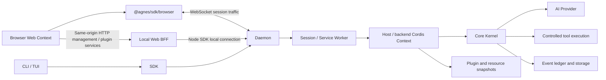

# Architecture: from a request to recoverable execution

English | [简体中文](architecture.zh-CN.md)

[Documentation](../README.md) · [Source map](source-map.md)

AGH runs tasks in a shared backend so CLI, Web, and SDK work with the same session state. Business tools and interfaces use distinct extension entry points and can be developed separately, then composed into an application. This guide follows a request through that architecture.

Clients present state, the daemon manages sessions and the control plane, Host assembles the runtime, and Core advances the model/tool loop. Models propose actions; model text does not decide tool authorization, execution, or persistent state.

## Business agents and the runtime

Business Loops, tools, model adapters and personas are replaceable plugins composed by Host. The official default Loop lives in [loop-default](../../packages/loop-default/src/index.ts), using public LoopContext ports; Core owns authorization, durable facts and recovery. [File memory](../guide/memory.md) stores learned preferences, while the ledger retains execution history.

Jev remains an exploratory structured-decision integration, without an installed Jev adapter.

## Runtime request path

## The two Web communication paths

The session path is `@agnes/sdk/browser` → WebSocket → daemon. `app.ts` reads the address from the page's `agnes-config` `data-ws` attribute and creates a client with `transport.kind: 'ws'`, protocol `agnes-v1`, and `auth.kind: 'local'`. Session creation/loading, prompts, events, and approvals use this connection without HTTP BFF forwarding. `local` does not waive server-side loopback, Origin, or permission checks.

Management and constrained plugin services use a same-origin HTTP BFF. Resource management uses `/admin/resources/api/...`; client plugin queries/effects use `/api/client-modules/service` and `/api/client-modules/effect`. The local Web process then calls the daemon through the Node SDK's local connection. Direct browser session connectivity does not give browser plugins Node management capabilities. `ClientContext` service relay remains constrained by the current session, row identity, and allow-list.

Code: [browser session client](../../packages/web/src/app.ts), [browser SDK exports and management restrictions](../../packages/sdk/src/index.browser.ts), [resource-management BFF](../../packages/resource-control-cli/src/admin-bff.ts), [plugin-service BFF](../../packages/cli/launch/package-admin.ts), [Web server](../../packages/web-server/src/server.ts).

## State ownership

| Layer | Main responsibilities |
| --- | --- |
| CLI/Web | User input, approval interaction, sessions, and result presentation |
| SDK | Protocol, transport, session handles, cursors, and request journal |
| daemon / worker | Shared instance and session directory, control plane, and approval routing; workers host execution environments |
| Host | Profiles, credentials, platform adapters, plugin assembly, and Kernel creation |
| Core | Execution state machine, event facts, and required capability seams |
| AI/Base/Code | Provider protocols, standard capabilities, and programmable workflows |

For each class of state — the sole authority, what other modules hold, and how disagreement is repaired — see [State ownership](state-ownership.md).

A prompt reaches the daemon through the SDK and is routed to a session worker. Host supplies model, tool, approval, sandbox, storage, and other seams for that session. Core generates the next step, records state, and consumes model or tool results. Clients read events or derived projections. Backend state determines cancellation, failure, parking, and recovery.

Core accepts a rejected-before-effect diagnostic from the Host-owned platform adapter's optional `HostToolDispatchPort.preflight`, before ToolRuntime or plugin execution, or from an invocation-bound proof minted by the Core-owned memory approval callback before candidate mutation. The memory proof is refused once another controlled effect or concurrent write may have started, and after write admission; CAS and post-commit metadata failures remain unknown. It validates the closed, bounded `RejectedBeforeEffectError` data at runtime and atomically records a failed tool result, `effect: "none"`, and an `error` settlement. Correctable `path`, `expected`, and `issues` appear in both model-visible text and structured data. A plugin's `INVALID_PARAMS` claim grants no such authority. Adapter throws, timeouts, disconnects, partial persistence and incomplete returns remain uncertain; mutation/never-replay calls retain unknown settlement and human reconciliation, without automatic redispatch.

## Seams and extensions

Human decisions have one durable authority: `decision/state`. Tool permission, unknown-outcome reconciliation, memory review, budget quotes and operation reviews bind an immutable subject to a decision handle, then record its answer and consumption. Approval seams deliver the question; clients and deferred invocations read the decision register. Machine guardian policy audits remain separate facts. Extensions review one-shot candidates through `ctx.decisions.review`; detached memory and operation candidates are withdrawn. A human reconciliation answer acknowledges an unknown outcome without replaying the effect. An answer given while the call still waits is consumed with the unknown result, named to the model, and the batch and turn continue; only an open question parks the turn, and an answer that arrives after it parked reopens that turn as an `approval-resume` continuation with the answer named to the model (the call is not replayed), and calls the parked batch never started are closed as `TOOL_NOT_STARTED`. A failure is definite, with no reconciliation, only when Core or a Host-owned port proves it happened before any effect: the memory approval callback, or a management bridge whose daemon refused the request with `INVALID_PARAMS` while nothing else in the call had started. An error code thrown by tool code is never such proof. Ledgers using the retired approval event format are unsupported.

A seam supplies a required part of execution, such as approval, billing, or sandbox behavior. Seven of them are provider kinds registered through `ctx.providers.register` and selected with `providers.<kind>: { provider }`; see [Seams](../extend/seams.md). Missing seams are refused (`E_SEAM_MISSING`) rather than silently skipped. Extensions contribute optional features such as tools, observation hooks, or client slots. Both can be assembled through Cordis, but they have different permission surfaces.

Trusted backend Cordis rows may contribute tools, hooks, and constrained services. A browser module is a separate runtime surface bound to a row; see [plugin boundaries](plugins.md). Frontend and backend Contexts do not share memory. Ordinary `ctx.provide()` is not a cross-process proxy. Browsers call row services through declared relays without obtaining Host management objects.

## Runtime targets and hot updates

PackageManager produces verified snapshots and governance state. A runtime target combines ordinary rows, resource rows, and platform-synthesized client rows. `web:` rows do not execute in Host's ordinary tree. Code publication creates a generation for new session bindings; retained sessions keep their code and matching client modules. Within a generation, Host reconciles eligible live resource rows, dependencies, and actual state in constrained transactions. Base backend changes require restart; failed compensation or tainted state may require a rebuild.

This supports incremental updates for eligible changes. Transactions do not cover external business effects. The frontend also reconciles its own roster and cleans up fibers, so inspect both backend actual state and page loading.

## MCP and Skills

The MCP control plane stores definitions, trust, and enablement. Session workers mount a Host `ext:` row per eligible server from resource snapshots. Startup and turn-boundary reloads use the same apply path; the dedicated resource-management service worker uses the manager. The session path currently skips OAuth bindings; see [MCP runtime behavior](../guide/mcp.md#runtime-behavior-and-versions) for the call chain and limits.

Skills combine disk/package resource governance with runtime Cordis contributions. The shared worker handles Skill scan/deletion commands, and Host's Skills row can refresh incrementally after resource changes. The session workspace determines visible disk Skills. This lifecycle differs from per-server MCP rows; do not assume each Skill source has its own Host row.

## App Server and clients

Each `AGH_HOME` has one authenticated daemon endpoint. The [App Server v1 contract](../reference/app-server.md) publishes generated JSON Schema and method-specific TypeScript types. `agh app-server --stdio` and ACP are connection bridges to that daemon. Management HTTP paths adapt the same RPC methods; composition, search, context, history and plan state are owned by the daemon. Errors retain numeric codes and carry safe localized message keys, allowlisted causes and diagnostic ids.

AGH's App Server provides shared task execution: the daemon manages sessions and the control plane, workers execute tasks, and the SDK provides communication entry points. Choose an integration path from the repository's [API contracts](../reference/api.md) when building a client.

Daemon assembly proceeds through the home owner lock, stores and snapshots, worker pool, private worker listener, runtime adapters, client-module rebuild, boot-verification end, client listeners and discovery. Each resource owner registers one lifecycle record in [AssemblyLifetime](../../packages/daemon/src/supervisor/assembly-lifetime.ts). Startup abort and normal shutdown use the same reverse list: stop intake and timers, drain within the worker grace period, force overdue workers, then dispose resources and release ownership after exit recovery. Bootstrap-only request/reference ports refuse calls before initialization and after close.

## Scope of reusable applications

FDE is a delivery approach. An FDE deployment can use AGH's existing extension paths for enterprise software. Knowledge retrieval, database connectors, business systems, and specialized interfaces require implementation and validation for each environment.

| Module and source ownership | FDE use through current software paths |
| --- | --- |
| App Server: [SDK](../../packages/sdk/src), [daemon](../../packages/daemon/src), [worker](../../packages/worker-runtime/src) | Shared sessions, task submission, events, approval routing, and client integration |
| Agent Loop: [Host assembly](../../packages/host/src/runtime/assemble/assemble.ts), [Core](../../packages/core/src), [AI](../../packages/ai/src) | Model/tool execution, task state, interruption handling, and recovery |
| Memory: [event records](../../packages/core-ledger/src/log), [resource governance](../../packages/resource-control-runtime/src) | Preserve task history and results; reuse methods through Skills |
| Execution constraints: [controlled tool execution](../../packages/core/src/step/tools.ts), [sandbox](../../packages/host-infrastructure/src/sandbox-seam.ts), [workspace policy](../../packages/host-common/src/workspace-policy.ts) | Tool approvals and applicable software execution constraints |
| Plugins: [Cordis](../../packages/cordis/src), [plugin runtime](../../packages/plugin-runtime/src), [package manager](../../packages/package-manager/src), [Web client modules](../../packages/web-client/src) | Backend tools/services, hooks, Skills, MCP connections, and business panels |

Ordinary backend plugins execute as trusted in-process code. A tool approval or available command sandbox does not isolate arbitrary plugin code. Approvals, sandbox behavior, and other required seams are selected by trusted deployment configuration; ordinary extensions do not acquire the right to replace them by registering a tool or hook. See [security and trust](../guide/security.md).

Source: [Host](../../packages/host/src/runtime/assemble/assemble.ts), [Worker](../../packages/worker-runtime/src/main.ts), [Core](../../packages/core/src), [Daemon](../../packages/daemon/src/supervisor/runtime.ts), [runtime-target publication](../../packages/host-providers/src/runtime-target-publisher.ts), [Web Context](../../packages/web/src/client-modules/boot.tsx).
