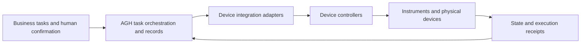

# MHS and device integration: bring tasks into the physical world

English | [简体中文](mhs.zh-CN.md)

[Project home](../../README.md) · [Documentation](../README.md) · [FDE and use cases](why-agh.md)

> **Source preview: native MHS device SDKs, a profile-owned Hub, plugin factories and browser module are available. Installed activation uses the generic profile managed runtime, native authority and authenticated streams. Physical-device acceptance is unverified.**

From inspection and maintenance to instrument coordination, field work connects device state, human judgment, and business workflows. The MHS plugin uses its own versioned command and MOS observation channels to bring state reads, operation requests and execution receipts into that task flow. MHS does not use MCP as its device transport.

In AGH's [architecture](../develop/architecture.md#brain-cerebellum-memory-and-body), device adapters connect task orchestration to physical capabilities. The devices and their controllers supply those capabilities, while AGH contributes task orchestration, human confirmation, and records. This direction can be part of an FDE deployment using the same software foundation.

We plan to publish guides and reproducible examples around these scenarios, helping developers combine device capabilities, human confirmation, and business interfaces into applications.

## How AGH plans to integrate

The following is a proposed division of responsibilities. Concrete interfaces still need validation:

AGH organizes tasks, authorization interactions, and result records. An adapter connects device capabilities to task execution, while the device controller owns actual motion and site protections. The [device SDK](../../packages/mhs-device/README.md) owns device declarations and local safety, the [Hub](../../packages/mhs-hub/README.md) owns device state and receipts, and the [Harness plugin](../../packages/mhs-plugin/README.md) consumes generic Host services. A Host without the profile-runtime contract fails closed; a browser never opens a bare North control socket.

The separate MCP-based [device-inspection bundle](../../examples/fde/device-inspection/README.md) demonstrates read status → detect an anomaly → obtain human confirmation → perform a constrained action → verify the receipt in a local simulator. Each device model, action, and failure path needs its own implementation and validation.

## Browser workbench

Official distributions install and enable the MHS package on a fresh home, so **MHS** appears as a first-level sidebar entry at first run. Open **MHS → Examples** to review and install/launch the bundled Mars rescue example. Disabling MHS in Plugins removes its entry. Existing homes are not backfilled; install and enable the package explicitly there.

The MHS client contributes a primary sidebar page with Devices, Map, Activity, Connect and Examples tabs, device detail, seven device-tool cards and a contextual session Devices workbench panel. Device lists and controls use profile services; viewing or stopping a device does not create a hidden chat session. Native approval and device-bound manual leases remain backend decisions. Unknown receipts offer read-only reconciliation rather than automatically dispatching another action.

Activity uses the Hub's seven-day window, earliest available timestamp and bounded cursor pages. Its current-session filter is disabled when no session is selected. The workbench count reflects devices used in the selected session and clears on a switch. Device details show confirmed source states and recent operation summaries; the device SDK reports paused only after reaching rest. Maps support declared landmarks, device trust/offline markers and point, pose or polygon targets.

Connect shows SDK usage, declarations and bounded protocol-event summaries. Managed health, public SDK endpoints, external settings and conformance require the host-owned diagnostics adapter. Examples use reviewed local package activation/launch and registered local scenes; installed and running are distinct states. See the [browser contract](../../packages/mhs-ui/README.md) for the remaining integration boundaries.

## What is coming

| Content | Planned scope | Status |
| --- | --- | --- |
| Integration guide | [SDK](../../packages/mhs-device/README.md), [Hub](../../packages/mhs-hub/README.md) and [browser module](../../packages/mhs-ui/README.md) contracts | Source preview |
| Examples and reproduction steps | [Simulated inspection](../../examples/fde/device-inspection/README.md), dry-run by default | Preview |
| Device verification notes | Supported models, software versions, test environments, and known limits | Coming soon |

Adapter designs, supported devices, and examples will be announced after validation. No opening date is set. Integration is exploratory: the simulator provides a software workflow example; no general-purpose MHS adapter or physical device has been validated.

## Separate MCP inspection seam (preview)

A package can declare `capabilities.device: true` on a plugin entry alongside its other capabilities. This adds the `device` review/policy atom to installation preview, capability hashes and allow/deny checks. It is an optional additive field: existing manifests retain their hash and behavior. It does not grant controller access, isolate plugin code or certify a device adapter.

The MCP bridge retains `readOnlyHint`, `destructiveHint` and `idempotentHint` and maps them to the existing tool policy metadata:

| MCP annotations | Tool metadata / default manual policy |
| --- | --- |
| Read-only, no destructive hint | Read-only, safe replay |
| Destructive hint, including contradictory read-only hint | Write, `requiresApproval: always` |
| Write with no idempotency assurance | `replay: never`, `requiresApproval: always` |
| Explicit non-destructive, idempotent write | `replay: idempotent`; other deployment policy still applies |

Missing write annotations remain conservative. Idempotency never pre-approves a destructive action. The default policy consumes this metadata in normal manual approval mode; explicit full-access or approval-off configuration retains its existing semantics. The device bundle supplies a policy that asks before every write even with those settings. The bridge does not infer safety limits or enforce remote idempotency from a hint.

The installable [device-inspection bundle](../../examples/fde/device-inspection/README.md) packages a public-port loop, tools, confirmation policy, Skill and a local stdio MCP simulator. It defaults to `dry_run: true`, accepts bounded cooling targets and version preconditions, rejects conflicting idempotency keys, and reads receipts plus state after action. A dry-run receipt proves a preview, not a changed temperature. Receipts live only in the simulator process. Unknown or interrupted effects stop for inspection rather than being replayed automatically.

This is **MHS-inspired**, with no MHS compatibility claim. Real integrations still need validated units, limits, controller permissions, durable deduplication and receipt reconciliation. See the [FDE bundle index](../../examples/fde/README.md) for installation and adaptation.

## Device control boundaries

The device and its control system remain responsible for real-time motion control, interlocks, emergency stops, and local takeover. Canceling an AGH task does not establish that a device has stopped safely. After a connection loss or missing receipt, inspect device state before repeating an action whose outcome is unknown. Desktop Computer Use verification does not establish physical device integration.

Start with [backend plugins](../develop/backend.md), [MCP](mcp.md), and [full-stack integration](../develop/fullstack.md) to understand the software extension paths. Share device requirements through the [feedback process](../develop/contributing.md). Code and documentation PRs remain limited to invited internal developers.

## Current status at a glance

**Native MHS source modules and a separate MCP inspection example are available.** A verified general-purpose MHS adapter and supported-device list remain future work. The simulator does not establish MHS compatibility or physical-device acceptance. Device controllers retain responsibility for real-time control and physical safety.

## Mars rescue example

The bundled [Mars rescue package](../../examples/mhs/mars-rescue/README.md) implements eleven simulated devices and an in-page procedural 3D scene. See the [Mars guide](mars-world.md) for lifecycle, business-Agent launch and integration status. Its reviewed producer binding now connects the installed parent runtime. Focused checks exercise registration, native approval, Stop and disable; full browser and physical-device acceptance remain separate.
